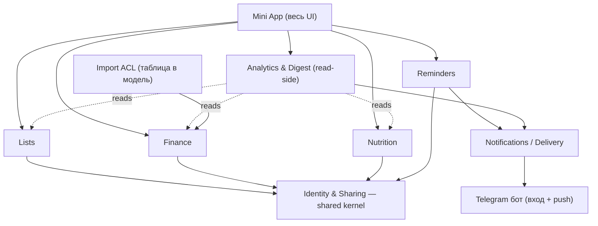

# Семейный ассистент — Доменная модель и границы bounded contexts

**Версия:** 1.3.2 (2026-06-07: §4 — `hidden_from` уточнён до H3-a, ассоц-таблица на сущность; §3.4 — КБЖУ-цели в Nutrition по `user_id`)
**Статус:** принято (архитектура — Sergei; продукт — Катя). Дата приёмки: 2026-06-04
**Опирается на:** `MVP_Requirements.md` v1.0 (SSOT по объёму)
**Дата:** 2026-06-03

---

## 1. Назначение и подход

Документ нарезает систему на bounded contexts и фиксирует их ответственность, ключевые понятия, модель приватности и зависимости. Уровень **концептуальный** — не схема БД и не ERD (они на этапе ТЗ/архитектуры). Полные атрибуты сущностей здесь намеренно не раскрываются.

Подход: **DDD-lite поверх модульного монолита**. Один процесс, одна БД, но логически — **пакет-на-контекст** (свои `models` / `repositories` / `services` / API-эндпоинты внутри каждого). Общее ядро (Identity & Sharing) — единственное, от чего зависят все остальные. В MVP контексты связаны **слабо**: единственная жёсткая общая зависимость — идентичность и модель видимости.

---

## 2. Карта контекстов

Шесть доменных контекстов + слой доставки/интерфейса.

- **Identity & Sharing** — shared kernel, вверх по зависимостям от всех.
- **Lists / Finance / Nutrition / Reminders** — доменные контексты, зависят только от Identity.
- **Analytics & Digest** — read-side: читает из трёх доменов, своей write-модели не имеет.
- **Notifications / Delivery** — supporting: доставляет push в Telegram (срабатывание напоминаний, дайджест, алерты об ошибках).
- **Import ACL** — единственная внешняя граница: парсит таблицу в модель Finance.

---

## 3. Контексты

### 3.1 Identity & Sharing (shared kernel)
- **Ответственность:** кто есть пользователь, кто его партнёр, и **кто что видит**.
- **Ключевые понятия:** `User`, `Family` (пара), `Membership`, `Invite` (инвайт-код, FSM-пейринг — есть в current-state). Модель видимости — first-class (раздел 4).
- **Канал:** пейринг — минимальный вход в чате; управление — Mini App.
- **Маппинг на код:** существующий family/pairing — **переиспользуется**, расширяется моделью видимости.

### 3.2 Lists
- **Ответственность:** типизированные списки с иерархией, метаданными, поиском, аналитикой по типу.
- **Ключевые понятия:** `List` (тип: дела / покупки / идеи / фильмы / подарки / ссылки), `ListItem`, иерархия категорий (Adjacency List — есть), метаданные (`created` / `completed` / `status`), история изменений.
- **Видимость:** по умолчанию `family`; **подарки — `hidden-from-partner`**.
- **Канал:** Mini App (переезд с чата).
- **Маппинг:** существующий модуль списков — **переработка** (типизация, метаданные, поиск, аналитика, переезд в Mini App, новый режим приватности).

### 3.3 Finance
- **Ответственность:** бюджет vs факт с иерархией категорий и аналитикой; данные импортируются из таблицы.
- **Ключевые понятия:** `Category` (двухуровневое дерево, **расширяемое** — таксономия +/- фиксирована, строки иногда добавляются), `BudgetPlan` (план по категории на период), `ActualAmount` (факт по подкатегории, дневная гранулярность), `Income` (источник, партнёр, переход остатка).
- **Import как anti-corruption layer:** парсер таблицы — отдельная **заменяемая** граница; переводит нерегулярный месячный лейаут в чистую доменную модель. Доменная модель **не зависит** от формы таблицы — критично, потому что таблицу через несколько месяцев существенно переработают. Меняется таблица → меняется только адаптер.
- **Видимость:** `family` (общий бюджет).
- **Канал:** Mini App (аналитика, графики, периоды).
- **Маппинг:** **новый**.

### 3.4 Nutrition
- **Ответственность:** дневник питания, КБЖУ, цели, история, общая база блюд.
- **Ключевые понятия:** `FoodEntry` (личный дневник по дням), `Meal` (завтрак / обед / ужин / перекус), `Dish` / `SharedFood` (общий каталог блюд — shared reference data), цели КБЖУ (хранятся в Nutrition по `user_id`, не на kernel-`User` — ADR-0004; ТЗ Identity OQ-4).
- **Особенность:** внутри контекста **двойная приватность** — дневник личный (`user_id`), каталог блюд общий.
- **Канал:** Mini App (есть).
- **Маппинг:** существующий модуль еды — **переиспользуется почти как есть**.

### 3.5 Reminders
- **Ответственность:** создание / просмотр / срабатывание напоминаний.
- **Ключевые понятия:** `Reminder` (текст, время / recurrence, владелец), `Scheduler` (механизм срабатывания — в ADR).
- **Сценарии MVP:** витамины, бытовые задачи. В MVP — **generic**, без жёсткой привязки к сущностям других доменов (проще; глубокие связи — North Star).
- **Канал:** создание/просмотр — Mini App; доставка — push (Notifications).
- **Маппинг:** **новый** (LLM-разбора напоминаний в current-state нет).

### 3.6 Analytics & Digest (read-side)
- **Ответственность:** аналитика по каждой сфере + ретро-дайджест.
- **Характер:** **read-side / проекция**. Своей write-модели нет; читает из Lists / Finance / Nutrition и агрегирует on-the-fly (объём данных крошечный). Дайджест — композиция недавних изменений по сферам, доставляется push.
- **Канал:** аналитика — Mini App; дайджест — push в чат.
- **Маппинг:** **новый** (у еды своя история есть, единого слоя нет).

### 3.7 Notifications / Delivery (supporting)
- **Ответственность:** доставка исходящих в Telegram — срабатывание напоминаний, ретро-дайджест, существующие алерты об ошибках админу.
- **Маппинг:** алерты — есть; push напоминаний/дайджеста — **новое**.

---

## 4. Модель видимости (центральный шов)

Три режима из требований сводятся к **одному** механизму. У shareable-сущности есть `owner` и правило видимости:

- **PERSONAL** — видит только `owner`. (Дневник еды, личные списки.)
- **FAMILY** — видят все члены семьи. (Списки по умолчанию, бюджет, каталог блюд.)
- **HIDDEN-FROM** — `FAMILY` минус явное исключение. (Подарки: family-scope, но `hidden_from = [одаряемый]`.)

То есть «скрытое-от-партнёра» — **не** отдельная третья ветка, а `FAMILY` с непустым множеством исключений. Унификация: базовый `scope` (`personal | family`) + опциональный `hidden_from`. `PERSONAL` эквивалентен «виден только owner».

**Принято в ADR-0001** (Вариант A): базовый `scope` (`personal | family`) + `hidden_from` как first-class у каждой shareable-сущности. `hidden_from` персистится нормализованной ассоц-таблицей **на каждую shareable-сущность** (H3-a, уточнено в ТЗ Identity §7; напр. `list_item_hidden_from`). Отвергнуты отдельная сущность видимости и ACL-слой (обоснование — в ADR-0001). Доменная модель требует лишь, чтобы видимость была first-class у каждой shareable-сущности, а не зашита в конкретный домен.

---

## 5. Связи между контекстами (и чего в MVP НЕТ)

- Единственная жёсткая зависимость — от **Identity & Sharing**: все контексты берут оттуда `User`/`Family` и применяют видимость.
- **Analytics** — downstream-читатель остальных; conformist, своей модели им не навязывает.
- **Reminders / Digest → Notifications → бот** — цепочка доставки.
- **Import ACL → Finance** — единственная внешняя граница.

Сознательно **не строим в MVP** (→ North Star), чтобы не повышать связность:
- Списки покупок ↔ Финансы (купленное → трата): в MVP финансы только импорт, ввода транзакций нет.
- Еда ↔ Финансы (категории здоровья/еды в бюджете пересекаются с питанием): совпадение, не связь.
- Reminders ↔ доменные сущности (напоминание про конкретный пункт списка): в MVP напоминания generic.

Это держит контексты слабо связанными — соответствует NFR простоты и облегчает будущее отделение фронта.

---

## 6. Маппинг на существующий код (вариант C)

| Целевой контекст | Существующий модуль | Действие |
|---|---|---|
| Identity & Sharing | family/pairing | переиспользовать + расширить видимостью |
| Lists | модуль списков (chat) | переработать (типизация, метаданные, поиск, аналитика, Mini App, приватность подарков) |
| Nutrition | модуль еды (Mini App) | переиспользовать почти как есть |
| Finance | — | новый |
| Reminders | — | новый |
| Analytics & Digest | — | новый (история еды остаётся внутри Nutrition) |
| Notifications | алерты об ошибках | переиспользовать + добавить push напоминаний/дайджеста |

**Структура кода и изоляция контекстов** зафиксированы в **ADR-0004** (Вариант B: пакет-на-контекст + общий `kernel`, enforced allowed-edges через `import-linter` из графа §2; эскиз дерева пакетов — там).

---

## 7. Интерфейсный слой и шов под standalone
- **Telegram-бот:** вход (запуск Mini App, `initData`) + push.
- **Mini App:** весь UI, говорит с backend по REST.
- **Шов под будущий standalone:** backend API не завязан на Telegram-специфику в доменной логике; аутентификация (`initData`) — заменяемый слой на границе. В MVP под это **не оверинженерим**, только держим логику доменов свободной от Telegram.

---

## 8. Открытые вопросы для ADR
Вынесено в единый live-трекер — `docs/03_architecture/adr/README.md` (SSOT по статусам ADR, открытым вопросам и недоспецификациям). Здесь не дублируется во избежание рассинхрона.

---

## 9. История изменений
- **1.3 (2026-06-04):** §8 заменён ссылкой на единый трекер `docs/03_architecture/adr/README.md` (устранено дублирование списка открытых вопросов).
- **1.2 (2026-06-04):** закреплено решение ADR-0004 (Вариант B: пакет-на-контекст + kernel + import-linter из графа §2); п. 4 открытых вопросов §8 помечен решённым; в §6 добавлен указатель на структуру кода.
- **1.1 (2026-06-04):** закреплено решение ADR-0001 в §4 (Вариант A: `scope`+`hidden_from`; персистенция hidden_from — join-таблица, H3); п. 1 открытых вопросов §8 помечен решённым.
- **1.0 (2026-06-04):** нарезка bounded contexts принята (архитектура — Sergei); опора обновлена на `MVP_Requirements.md` v1.0; добавлен указатель на входы в ADR. Продуктовый sign-off (Катя) получен в тот же день — нарезка принята полностью (архитектура + продукт).
- **0.1 (2026-06-03):** первичная нарезка bounded contexts по итогам requirements v0.3.
