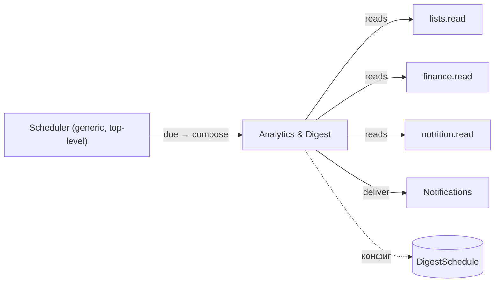

# ТЗ — Analytics & Digest (read-side)

**Версия:** 0.4 (принято; Q1-А10/Б4 влиты)
**Статус:** ✅ Принято (С./Катя, 2026-06-07)
**Дата:** 2026-06-07
**Опирается на:** `MVP_Requirements.md` §4.5/§5/§9 · `DOMAIN_MODEL.md` §2/§3.6/§4 · `ADR-0003` (триггер дайджеста — общий poll-loop) · `ADR-0004` (изоляция; `analytics → contexts.*.read`) · принятые ТЗ Lists/Finance/Nutrition (их `read`-модули), Reminders (scheduler), Notifications (доставка)
**Закрывает:** контекст «Analytics & Digest» — **последний домен фазы ТЗ**.
**Грунт:** req §4.5, DOMAIN_MODEL §3.6, ADR-0003. Код — **новый** (current-state: у еды своя история, единого слоя нет).
**Продуктовый вход (Катя, 2026-06-07):** каденс дайджеста — **настраиваемый**; состав — **Списки + Финансы + Питание** (сводка напоминаний в дайджест **не входит**).

---

## 1. Назначение и границы контекста

Analytics & Digest — **read-side / проекция**: своей write-модели нет (кроме конфига расписания дайджеста). Читает из Lists / Finance / Nutrition через их **`read`-модули** (ADR-0004), агрегирует **on-the-fly** (объём крошечный, без предрасчёта — req §9). Две функции: (1) аналитика по сферам; (2) **ретро-дайджест** — периодическая сводка недавних изменений, push в чат.

**Входит:** кросс-сферная read-композиция; ретро-дайджест (настраиваемое расписание `DigestSchedule`, композиция per-recipient с учётом видимости, триггер через общий scheduler, доставка через Notifications); конфиг расписания.

**НЕ входит:** write-модели доменов; **детальная внутридоменная аналитика** — живёт в самих доменах (Lists `/lists/analytics`, Finance `/finance/analytics` уже специфицированы); Analytics их **переиспользует через `read`**, не дублирует. Доставка push — Notifications; сам механизм срабатывания — Reminders/scheduler (ADR-0003).

**Граница с доменной аналитикой (важно):** per-type аналитика списков и план/факт финансов **остаются в своих доменах**. Analytics добавляет **единый обзор** (композиция reads) и **дайджест**. Дублирования агрегаций нет.

**Маппинг:** новый слой. Conformist-читатель (DOMAIN_MODEL §3.6): своей модели доменам не навязывает.

---

## 2. Глоссарий контекста
- **Ретро-дайджест** — сводка «что произошло» за период (в отличие от forward-напоминаний).
- **DigestSchedule** — конфиг расписания дайджеста (каденс + время).
- **read-модуль** — публичная проекция домена для чтения аналитикой (`contexts.<домен>.read`).
- **Композиция per-recipient** — дайджест собирается под конкретного получателя с учётом видимости (личное питание — своё; скрытые элементы исключены).
- scope, visible_to — см. ТЗ Identity.

---

## 3. Модель (read-side; единственная сущность — конфиг)

Своей доменной write-модели **нет**. Единственное персистентное — конфиг расписания.

### 3.1 DigestSchedule — расписание дайджеста (несколько на семью)

Семья держит **несколько расписаний одновременно** — ежедневное + еженедельное (решение Кати). Одна строка на (семья, каденс).

| Поле | Тип | NULL | Описание / инвариант |
|---|---|---|---|
| `id` | int PK | нет | — |
| `family_id` | FK→Family | нет | Семья. **Unique вместе с `cadence`** (≤1 daily + ≤1 weekly на семью). |
| `cadence` | enum | нет | `DAILY` / `WEEKLY`. |
| `weekday` | int | да | Для `WEEKLY` (0–6; вс=6). |
| `time_of_day` | time | нет | Время отправки в таймзоне семьи (= `User.timezone` участников; в MVP оба в одной зоне — берётся владелец семьи; аудит F6.4). |
| `enabled` | bool | нет | Включено. Default true. |
| `last_sent_at` | datetime | да | База периода «с прошлого раза» — **своя у каждого расписания**. |

**Дефолт-сид (Катя):** ежедневный **23:59** + еженедельный **вс 23:00**.
Всё остальное — **проекции on-the-fly** из `read`-модулей, не хранятся.

---

## 4. Зависимости чтения (ERD-контекст)



Analytics читает только публичные `read`-проекции доменов (не их `services`/`models`) — ADR-0004.

---

## 5. Инварианты и бизнес-правила
- **I1. (read-only)** Своей write-модели нет (кроме `DigestSchedule`); агрегации on-the-fly, без предрасчёта (req §9).
- **I2. (изоляция)** доступ к доменам — **только** через `contexts.*.read`; прямой импорт `services`/`models` запрещён (import-linter, ADR-0004).
- **I3. (видимость)** аналитика и дайджест включают только видимое получателю: FAMILY-данные (списки/финансы) — обоим; PERSONAL (питание) — владельцу; скрытые `hidden_from` элементы исключены (как в Notifications I2).
- **I4. (композиция per-recipient)** дайджест собирается под каждого получателя отдельно: общие сферы (списки/финансы) одинаковы, питание — личное; пуш обоим партнёрам.
- **I5. (состав)** дайджест = **Списки + Финансы + Питание** (решение Кати); **сводка напоминаний не включается**.
- **I6. (период)** охват дайджеста — «с `last_sent_at`» (для настраиваемого каденса); после отправки `last_sent_at` обновляется.
- **I7. (каденс)** настраиваемый через `DigestSchedule`; **несколько расписаний на семью** (ежедневное + еженедельное одновременно), у каждого свои `time_of_day`/`last_sent_at` и охват (день/неделя); триггер — общий scheduler (ADR-0003), не свой loop.

---

## 6. Аналитика по сферам

Единый read-обзор поверх доменных `read`-проекций (детализация — в доменах):
- **Списки:** агрегаты по типу за период (просмотренные фильмы, выполненные дела, динамика) — через `lists.read`.
- **Финансы:** план/факт/разница/% по категориям, иерархия, доходы — через `finance.read` (домен уже считает; Analytics композирует обзор).
- **Питание:** КБЖУ за период vs цели (личное) — через `nutrition.read`.

Всё on-the-fly, видимость-фильтровано (I3). Analytics **не пересчитывает** то, что считают домены, — берёт их проекции.

---

## 7. Ретро-дайджест

**Расписание:** `DigestSchedule` — **несколько на семью** (ежедневное + еженедельное), у каждого своё время. **Триггер:** **digest-job Analytics**, зарегистрированная в generic-планировщике (top-level `scheduler/`) из `main.py` (аудит F2.1 — Analytics **не зависит** от Reminders; оба — отдельные job одного планировщика). На тике job проверяет все «созревшие» расписания (`enabled`, наступило время относительно своего `last_sent_at`) → `compose_digest(recipient, период)` → **Notifications.deliver** → обновляет `last_sent_at` этого расписания. Своего event-loop Analytics не держит (один механизм на напоминания и дайджест — ADR-0003).

**Композиция (per-recipient, I4), за период с `last_sent_at`** соответствующего расписания (ежедневное ≈ день, еженедельное ≈ неделя)**:**
- **Списки:** изменения в видимых получателю FAMILY-списках (добавлено/выполнено), по типам; **источник — recent-changes-проекция `lists.read` по полям `ListItem`** (`created_at`/`completed_at` в периоде; `ListItemHistory` не источник — она капится; Q1-А10/CH-5); скрытые элементы исключены.
- **Финансы:** ключевые отклонения план/факт за период (последний импортированный месяц); **крупные траты = top-3 расходов периода по сумме, без порога** (Q1-Б4 — туда попадают и разовые крупные покупки типа велосипеда).
- **Питание:** личная сводка КБЖУ/цели получателя (PERSONAL).
- **Напоминания — НЕ включаются** (I5).

Пустые секции скрываются; полностью пустой дайджест — не шлём.

---

## 8. Прикладные сценарии
- **S1. Настроить.** Семья держит два расписания: ежедневное (23:59) и еженедельное (вс, 23:00); `PUT /analytics/digest/schedules/{cadence}` правит каждое.
- **S2. Авто-дайджест.** Scheduler видит, что расписание созрело → Analytics композирует per-recipient → Notifications шлёт push обоим → `last_sent_at=now`.
- **S3. Превью.** `GET /analytics/digest/preview` → текущая композиция дайджеста для зрителя (без отправки).
- **S4. Обзор.** `GET /analytics/overview?from=&to=` → кросс-сферная сводка (списки/финансы/питание), видимость-фильтровано.

---

## 9. REST-контракт

Под `/api/v1/analytics`, аутентификация — kernel `current_viewer`; видимость-фильтровано; ru.

| Метод | Путь | Назначение | Запрос | Ответ | Ошибки |
|---|---|---|---|---|---|
| GET | `/analytics/overview` | Кросс-сферная сводка | `?from=&to=` | `OverviewDTO` | 401,403 |
| GET | `/analytics/digest/preview` | Превью текущего дайджеста (для зрителя) | — | `DigestDTO` | 401,403 |
| GET | `/analytics/digest/schedules` | Список расписаний (daily/weekly) | — | `[DigestScheduleDTO]` | 401,403 |
| PUT | `/analytics/digest/schedules/{cadence}` | Задать расписание (время/weekday/вкл) | `{enabled?,weekday?,time_of_day}` | `DigestScheduleDTO` | 401,403,422 |

Детальная per-sphere аналитика — эндпоинты доменов (`/lists/analytics`, `/finance/analytics`) — Analytics их не дублирует.

**DTO:**
- `OverviewDTO` = `{range, lists:{by_type:[…]}, finance:{plan,fact,diff,top_deviations:[…]}, nutrition:{kcal,goal,…}}` (секции — по видимости).
- `DigestDTO` = `{period, sections:[{sphere, items:[…]}]}` (композиция per-recipient).
- `DigestScheduleDTO` = `{enabled, cadence, weekday?, time_of_day, last_sent_at}`.

---

## 10. Структура пакета и публичная граница (ADR-0004)

```
app/analytics/
  read_composition.py   # сбор обзора/дайджеста из contexts.*.read
  digest.py             # compose_digest(recipient), правила состава
  schedule.py           # DigestSchedule (конфиг), «созрело ли»
  api/                  # REST Mini App (/api/v1/analytics)
```
**Импорты:** `analytics → kernel + contexts.lists.read + contexts.finance.read + contexts.nutrition.read + notifications + generic scheduler` (регистрация digest-job). **Запрещено:** `services`/`models` доменов, `delivery`, **`reminders`** (аудит F2.1 — Analytics и Reminders связаны только composition-слоем `main.py`, не импортом). import-linter держит контракт.

---

## 11. Edge-cases и обработка ошибок
- **Пустой период** (ничего не менялось) → секции скрыты; полностью пустой дайджест не отправляется.
- **Скрытый элемент** (gift `hidden_from`) → не попадает в дайджест/обзор исключённого (I3).
- **Питание партнёра** → в его дайджест не попадает (PERSONAL, I4).
- **Финансы не импортированы за период** → секция финансов пуста/пропущена.
- **Расписание выключено** (`enabled=false`) → дайджест не шлётся; обзор в Mini App доступен.
- **Пропуск тика дайджеста** (рестарт) → misfire-политика scheduler (ADR-0003): догнать в грейсе или пропустить (по `last_sent_at`, без дублей).
- **Недоставка push** → политика Notifications (ретрай + алерт).

---

## 12. Нефункциональные аспекты
- **On-the-fly** агрегации; объём крошечный — предрасчёта/материализации нет (req §9, frozen §5).
- **Read-only conformist** — Analytics не пишет в домены, не навязывает модель (DOMAIN_MODEL §3.6).
- **Один scheduler** на напоминания и дайджест (ADR-0003); **один исходящий шов** (Notifications).
- Видимость — горячий инвариант (I3); локализация ru; standalone-шов (домен Telegram-агностичен; пуш — через Notifications).

---

## 13. Критерии приёмки
- **A1.** Кросс-сферный обзор (списки/финансы/питание) считается on-the-fly через `read`-модули, видимость-фильтровано.
- **A2. (дайджест)** по настроенному каденсу scheduler триггерит композицию; Notifications шлёт push обоим; `last_sent_at` обновляется; повторно не дублируется.
- **A3. (состав)** дайджест включает Списки+Финансы+Питание, **без** напоминаний; пустые секции скрыты.
- **A4. (видимость/per-recipient)** скрытые элементы и чужое питание не попадают в дайджест/обзор получателя.
- **A5. (изоляция)** Analytics импортирует только `contexts.*.read` (+ kernel/notifications); прямой доступ к `services`/`models` доменов падает в import-linter.
- **A6.** `DigestSchedule` настраивается (каденс/время/вкл); выключение останавливает рассылку.

---

## 14. Решённые вопросы (закрыты С./Катя, 2026-06-07)
- **OQ-A1 — расписание:** per-**семья** (не per-user); питание персонализируется в композиции.
- **OQ-A2 — каденс:** **несколько расписаний на семью**. Дефолт — ежедневный **23:59** + еженедельный (**вс**) **23:00**; время/weekday/вкл настраиваются. `DAILY/WEEKLY` покрывают MVP; произвольные правила — North Star.

> Решено инлайн: состав дайджеста — Списки+Финансы+Питание, без напоминаний (Катя); per-sphere детализация — в доменах (без дублирования); on-the-fly без предрасчёта (req §9).

---

## 15. История изменений
- **0.4 (2026-06-10):** влиты решения Q1: источник изменений списков — recent-changes из `lists.read` по полям ListItem, history не используется (А10/CH-5); «крупные траты» = top-3 по сумме без порога (Б4).
- **0.3 (2026-06-07):** аудит F2.1 — триггер дайджеста переразведён: digest-job Analytics регистрируется в generic top-level `scheduler/` из `main.py`; убрана зависимость от Reminders (ребро `reminders→analytics` устранено). §4/§7/§10 обновлены.
- **0.2 (2026-06-07):** закрыты OQ-A1/A2. Расписание per-семья; `DigestSchedule` стал **мульти-каденсным** (несколько на семью): дефолт ежедневный 23:59 + еженедельный вс 23:00, у каждого свой `last_sent_at`/охват. REST schedule → коллекция. Статус → принято. **Последний ТЗ — фаза закрыта 7/7.**
- **0.1 (2026-06-07):** первый черновик ТЗ Analytics & Digest (последний домен). Зафиксированы: read-side роль (чтение через `contexts.*.read`, без write-модели), `DigestSchedule` (настраиваемый каденс), композиция ретро-дайджеста per-recipient с учётом видимости (Списки+Финансы+Питание, без напоминаний — решение Кати), триггер через общий scheduler (ADR-0003) + доставка Notifications, граница с доменной аналитикой (без дублирования), REST + DTO, структура пакета, инварианты I1–I7, критерии A1–A6. 2 OQ (расписание на семью/юзера; глубина каденса).
