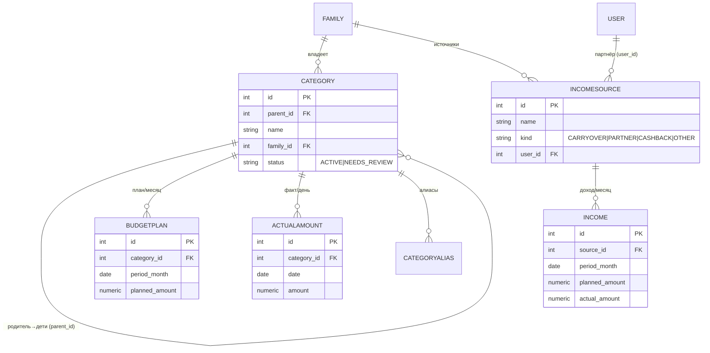
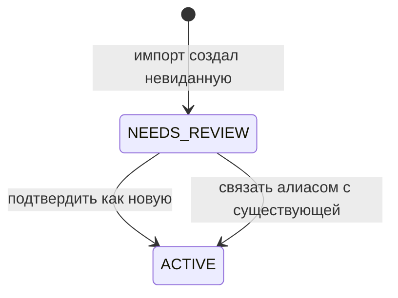

# ТЗ — Finance (бюджет vs факт + Import ACL)

**Версия:** 0.2 (принято; OQ-F1/F2/F3/F5 закрыты)
**Статус:** ✅ Принято (С./Катя, 2026-06-07)
**Дата:** 2026-06-07
**Опирается на:** `MVP_Requirements.md` §4.2/§5/§9/§10 · `DOMAIN_MODEL.md` §2/§3.3/§4 · `ADR-0002` (импорт, ACL) · `ADR-0004` (изоляция) · `ADR-0005` (SQLite→Postgres) · ТЗ Identity (`Shareable`)
**Закрывает:** контекст «Finance» доменной модели + action items ADR-0002 №3 (промежуточное представление и валидация), №4 (модель алиасов и поток ревью).
**Грунт:** реальный `docs/Бюджет общий 2026.xlsx` (4 листа Март–Июнь, **открыт и разобран** 2026-06-07), req §4.2, ADR-0002. Код Finance — **новый** (current-state нет).

---

## 1. Назначение и границы контекста

Finance — аналитика **бюджет vs факт** с иерархией категорий и доходами. В MVP источник истины — внешняя таблица; данные **импортируются → анализируются**. Ввод транзакций в боте — North Star. Зависит только от kernel.

**Входит:** доменная модель (категории-дерево, план, факт с дневной гранулярностью, доходы по источникам/партнёрам, переходящий остаток); аналитика (план/факт/разница/%, иерархия, каденс D/W/M/Q/Y + произвольный период); **Import ACL** — заменяемый адаптер `xlsx → домен` (ADR-0002); REST Mini App; `read`-модуль для Analytics.

**НЕ входит:** ввод транзакций, ФНС/чеки, сравнение цен (North Star); разбивка по картам (сознательно не нужна, req §4.2); сквозной дайджест (Analytics).

**Видимость:** весь контекст — **FAMILY** (общий бюджет, DOMAIN_MODEL §3.3). Применяется kernel-`scope=FAMILY`; `PERSONAL`/`hidden_from` в Finance MVP не используются.

**Маппинг:** новый домен. Существующего кода нет — пишется с нуля к чистой target-модели, не зависящей от формы таблицы (req §10).

---

## 2. Глоссарий контекста
- **Категория** — статья расходов; двухуровневое дерево (родитель → подкатегории).
- **Подкатегория** — лист дерева; идентичность = **(родитель, имя)** (имена не глобально уникальны: «Прочее» — и родитель, и подкатегория).
- **План / Факт / Разница** — плановая, фактическая сумма и их дельта по статье (терминология таблицы).
- **Доход** — поступление по источнику за месяц (партнёры, кэшбек, переходящий остаток, прочее).
- **Переходящий остаток** — «Переход с предыдущего месяца» как доходный источник.
- **Import ACL** — изолированный заменяемый адаптер, превращающий xlsx в доменную модель.
- **Период** — грань агрегации: день / неделя / месяц / квартал / год / произвольный.

---

## 3. Фактическая структура источника (сверено по файлу 2026-06-07)

- **Лист = месяц** (Март/Апрель/Май/Июнь; до 12/год). 39 колонок, ~1004 строки.
- **Строка-шапка (R1):** доход — `A` Доход, `B` План, `C` Факт, `D` Разница; расход — `E` Расходы, `F` План, `G` Факт, `H` %; **дневная матрица** `I…AM` = дни 1–31. Доход и расход — **параллельные колонки**.
- **Доход (A–D):** источники (Переход с предыдущего месяца, Катя, Сережа, Кэшбек, Прочее) + **сводные строки** «Доход» (Σ доходов), «Дельта» (доход − расход), «Расход» (зеркало итога расходов).
- **Расход (E–H + дни):** двухуровневое дерево. **Родитель — заливка ячейки `E` = `FFF9CB9C`**; подкатегория — без заливки. Инвариант (10/10 листов): `Факт` родителя = Σ `Факт` детей; дневная строка родителя = Σ детей.
- **Уточнение к ADR-0002 (по факту):** `FFF9CB9C` встречается **и** на сводной строке «Дельта» в доходном блоке → детект родителя скоупится на **колонку `E`**; сводные строки доходов ловятся **по имени** (Доход/Дельта/Расход), сводные расходов — по заливке `FFD9D9D9`/`FFFFE599`. Док-синк ADR-0002 §структура — см. OQ-F-док.
- Позиции строк и состав плавают по месяцам; бывают **частично заполненные** месяцы (Июнь: план есть, факт 0).

---

## 4. Доменная модель (чистая, независимая от таблицы)

### 4.1 Category — статья расходов (дерево, 2 уровня)
| Поле | Тип | NULL | Описание / инвариант |
|---|---|---|---|
| `id` | int PK | нет | — |
| `parent_id` | FK→Category | да | NULL = корневая (родитель); иначе — подкатегория. Глубина = 2 (I1). |
| `name` | str | нет | Имя. Уникально **в пределах родителя** (I2). |
| `family_id` | FK→Family | нет | Общий бюджет (FAMILY). |
| `status` | enum | нет | `ACTIVE` / `NEEDS_REVIEW` (невиданная при импорте). |
| `created_at` | datetime | нет | — |

Unique(`parent_id`, `name`, `family_id`). Расширяемая управляемая сущность (req §9) — импорт абсорбирует новые.

### 4.2 CategoryAlias — таблица алиасов (ADR-0002)
| Поле | Тип | NULL | Описание |
|---|---|---|---|
| `id` | int PK | нет | — |
| `alias_name` | str | нет | Нормализованное имя-дубль («Тренеровки»). Unique. |
| `category_id` | FK→Category | нет | Канон. |

Без авто-fuzzy-слияния: только явные алиасы + ручное подтверждение.

### 4.3 BudgetPlan — план по категории на месяц
| Поле | Тип | NULL | Описание / инвариант |
|---|---|---|---|
| `id` | int PK | нет | — |
| `category_id` | FK→Category | нет | Может быть план на родителе и/или на детях. |
| `period_month` | date(год-месяц) | нет | Месяц (лист). |
| `planned_amount` | numeric | нет | План. |

Unique(`category_id`, `period_month`). План **не** обязан = Σ детей (инвариант — только на факте/днях, см. I3).

### 4.4 ActualAmount — факт, дневная гранулярность (на листе)
| Поле | Тип | NULL | Описание / инвариант |
|---|---|---|---|
| `id` | int PK | нет | — |
| `category_id` | FK→Category | нет | **Лист** дерева (факт хранится на подкатегории; родитель = агрегат). |
| `date` | date(день) | нет | Конкретный день. |
| `amount` | numeric | нет | Сумма за день. |

Unique(`category_id`, `date`). Разрежённо (только ненулевые дни). Месяц/период/родитель — агрегации on-the-fly (`SUM`). Импорт **валидирует** строку родителя = Σ детей (I3), но хранит на листе.

### 4.5 IncomeSource — источник дохода (управляемый)
| Поле | Тип | NULL | Описание |
|---|---|---|---|
| `id` | int PK | нет | — |
| `name` | str | нет | «Переход с предыдущего месяца», «Катя», «Сережа», «Кэшбек», «Прочее». |
| `kind` | enum | нет | `CARRYOVER` / `PARTNER` / `CASHBACK` / `OTHER`. |
| `user_id` | FK→User | да | Для `PARTNER` — связь с участником (OQ-F1). |
| `family_id` | FK→Family | нет | FAMILY. |

### 4.6 Income — доход по источнику за месяц
| Поле | Тип | NULL | Описание |
|---|---|---|---|
| `id` | int PK | нет | — |
| `source_id` | FK→IncomeSource | нет | — |
| `period_month` | date | нет | Месяц. |
| `planned_amount` | numeric | да | План. |
| `actual_amount` | numeric | да | Факт. |

Unique(`source_id`, `period_month`). Сводные строки листа (Доход/Дельта/Расход) **не хранятся** — выводятся аналитикой.

---

## 5. ERD



---

## 6. Инварианты и бизнес-правила
- **I1.** Дерево категорий — ровно **2 уровня**: у родителя `parent_id=NULL`, у подкатегории `parent_id` указывает на родителя (не на подкатегорию).
- **I2.** Идентичность подкатегории = (`parent_id`, `name`); имена не глобально уникальны.
- **I3.** **Структурный инвариант источника:** `Факт` родителя = Σ `Факт` детей и дневная строка родителя = Σ детей. Проверяется при импорте; расхождение → fail-loud (ничего не пишем). Факт хранится на листьях, родитель — агрегат.
- **I4.** План — per-category (на родителе и/или ребёнке); инвариант суммы на план **не** распространяется.
- **I5.** Сводные строки листа (Доход/Дельта/Расход) — производные, **не хранятся**; считаются аналитикой (Доход=Σ источников, Расход=Σ факт-листьев, Дельта=Доход−Расход).
- **I6.** Импорт **идемпотентен по месяцу**: повторный импорт листа перезаписывает данные месяца (план/факт/доход), дублей нет.
- **I7.** Невиданная категория при импорте создаётся `NEEDS_REVIEW`, **никогда** не сливается по нечёткому совпадению (ADR-0002). Лечение дублей — алиас + подтверждение.
- **I8.** Весь Finance — FAMILY; оба партнёра видят и (в North Star) правят.

---

## 7. Import ACL — заменяемый адаптер (`finance/importing`)

Изолированный подпакет Finance (ADR-0004); единственная внешняя граница (DOMAIN_MODEL §2). Чистая функция `xlsx bytes → доменная модель`. Смена таблицы → переписываем **только** его.

**Поток:**
1. **Доступ:** загрузка `.xlsx` через Mini App (без Google API/OAuth — ADR-0002 A1).
2. **Парсинг (структурный, P2 — без хардкода номеров строк):**
   - Лист → месяц (имя листа → год-месяц).
   - Колонки — по шапке R1: доход `A–D`, расход `E–H`, дни `I–AM`.
   - Расход: родитель = заливка `E` `FFF9CB9C`; подкатегории — последующие незалитые строки до следующего родителя; (родитель, имя) — идентичность; план `F`, факт `G`, дни `I–AM`.
   - Доход: строки-источники в `A–D`; **сводные** (Доход/Дельта/Расход) распознаются по имени и исключаются; расходные сводные/«Итог» — по заливке `FFD9D9D9`/`FFFFE599`.
3. **Промежуточное представление (pre-domain):** `MonthParse { month, income[], categories[parent{children[], plan, fact, days[]}] }` — структурировано, ещё не в БД.
4. **Валидация:** `родитель.факт == Σ дети.факт` и `родитель.день == Σ дети.день` (с допуском на округление); план/факт числовые; sanity доходных сводных. На расхождении — **fail-loud**: отчёт о нераспознанном, **без частичного импорта**.
5. **Нормализация таксономии:** детерминированная (trim/регистр/пробелы) + таблица алиасов; невиданная категория → создаётся `NEEDS_REVIEW`. Без fuzzy-слияния (ADR-0002).
6. **Upsert:** идемпотентно по месяцу (транзакция: перезапись BudgetPlan/ActualAmount/Income месяца).

**Страховка к хрупкости заливки:** если формат заливки изменится, fallback — инвариант `родитель = Σ детей` (определяем родителя по агрегату); при неоднозначности — fail-loud (ADR-0002 §последствия).

---

## 8. Состояния (категория на ревью)


Поток ревью — пользовательский (Катя), OQ-F3.

---

## 9. Прикладные сценарии
- **S1. Импорт.** Пользователь экспортирует лист(ы) и грузит xlsx → ACL парсит → валидирует (родитель=Σ) → upsert по месяцу → отчёт (что импортировано, какие категории на ревью).
- **S2. Повторный импорт.** Тот же месяц заново → перезапись без дублей (I6).
- **S3. План/факт.** `GET /finance/analytics?period=M&month=2026-03` → по категориям план/факт/разница/%, агрегат по родителю + drill-down.
- **S4. Доходы.** Доход по партнёрам (Катя/Сережа), кэшбек, переходящий остаток; Дельта = доход − расход.
- **S5. Каденс.** Квартал/год = агрегация по месячным листам; произвольный период — по дням (`ActualAmount.date`).
- **S6. Новая категория.** В листе появилась «Подписки» → создаётся `NEEDS_REVIEW`; пользователь подтверждает/алиасит.

---

## 10. REST-контракт

Под `/api/v1/finance`, аутентификация — kernel `current_viewer`; данные FAMILY; ru.

| Метод | Путь | Назначение | Запрос | Ответ | Ошибки |
|---|---|---|---|---|---|
| POST | `/finance/import` | Загрузить и импортировать xlsx | multipart `file` | `ImportResultDTO` | 401,403,422 (структура/валидация) |
| GET | `/finance/months` | Импортированные месяцы | — | `[MonthDTO]` | 401,403 |
| GET | `/finance/categories` | Дерево категорий | `?status=` | `[CategoryNodeDTO]` | 401,403 |
| GET | `/finance/categories/review` | Очередь на ревью | — | `[CategoryNodeDTO]` | 401,403 |
| POST | `/finance/categories/{id}/resolve` | Подтвердить/алиасить | `{action:"accept"\|"alias", target_id?}` | `CategoryNodeDTO` | 401,403,404,422 |
| GET | `/finance/analytics` | План/факт/разница/% | `?metric=&period=&from=&to=&category_id=` | `AnalyticsDTO` | 401,403,422 |
| GET | `/finance/income` | Доходы по источникам/партнёрам | `?from=&to=` | `IncomeReportDTO` | 401,403 |

**DTO:**
- `ImportResultDTO` = `{months:[{month, categories:int, income:int}], created_for_review:[CategoryNodeDTO], status:"ok"\|"failed", errors:[{row, reason}]}`
- `CategoryNodeDTO` = `{id, name, parent_id, status, children:[CategoryNodeDTO]}`
- `AnalyticsDTO` = `{period, range, total:{plan,fact,diff}, lines:[{category_id, name, plan, fact, diff, pct, children:[…]}]}`
- `IncomeReportDTO` = `{range, by_source:[{source, kind, partner?, plan, fact}], carryover, total_income, total_expense, delta}`
- `MonthDTO` = `{month, imported_at, categories, has_facts}`

---

## 11. Аутентификация и авторизация
- Аутентификация — kernel (`current_viewer`).
- Авторизация — FAMILY: оба партнёра видят весь Finance. **Применение видимости (аудит F1.2):** Finance-сущности несут `family_id` (не полный `Shareable`-миксин со `scope`/`owner_id`); скоупинг — один `WHERE family_id=…` в репозиториях/`read`, `visible_to` к ним не прикладывается (весь домен FAMILY; `PERSONAL`/`hidden_from` не используются).
- Standalone-шов: домен/аналитика Telegram-агностичны; импорт принимает `bytes` + `viewer`, не зависит от канала (ADR-0004).

---

## 12. Структура пакета и публичная граница (ADR-0004)

```
app/contexts/finance/
  models/         # Category, CategoryAlias, BudgetPlan, ActualAmount, IncomeSource, Income
  repositories/   # category_repo, budget_repo, actual_repo, income_repo
  services/       # analytics_service (план/факт/иерархия/каденс), taxonomy_service (алиасы/ревью)
  api/            # REST Mini App (/api/v1/finance)
  read/           # проекции для Analytics (агрегаты план/факт по периодам)
  importing/      # ЗАМЕНЯЕМЫЙ ACL: xlsx-парсер (openpyxl), валидатор, маппер в домен
```

**Импорты (import-linter):** `contexts.finance → только kernel`; `finance.importing` импортируется **только внутри** `finance` (изолирован); `analytics` читает только `contexts.finance.read`; `delivery` зовёт `finance.api`. openpyxl/xlsx-специфика **заперта** в `importing` — домен и аналитика её не видят (заменяемость, ADR-0002).

---

## 13. Edge-cases и обработка ошибок
- **Структурное несоответствие** (родитель ≠ Σ детей, нечисловой факт, неузнанная шапка) → **422**, fail-loud отчёт, **ничего не импортировано** (I3).
- **Частично заполненный месяц** (Июнь: план есть, факт 0) → импортируется (план + нулевой факт), валиден.
- **Изменилась заливка** → fallback на инвариант суммы; неоднозначность → fail-loud.
- **Дубль имени под разными родителями** («Прочее») → ок ((parent,name), I2).
- **Невиданная категория** → `NEEDS_REVIEW` (I7), не fuzzy-слияние.
- **Повторный импорт месяца** → идемпотентная перезапись (I6).
- **Пустой/отсутствующий лист** → пропуск с пометкой в отчёте.

---

## 14. Нефункциональные аспекты
- **Импорт по требованию** (ручная загрузка; каденс неделя/месяц) — без тяжёлой инфры (ADR-0002).
- **Аналитика on-the-fly** (`SUM`/`GROUP BY`); объём крошечный (~12 листов/год) — предрасчёта нет (req §9).
- **Fail-loud** важнее частичного импорта (безопасность данных, ADR-0002 драйвер 4).
- **Заменяемость ACL** — главный НФР домена: переезд таблицы → только `importing`.
- **Портируемость БД** (numeric/date) изолирована; ru; standalone-шов.

---

## 15. Критерии приёмки
- **A1.** Импорт Март–Июнь из реального xlsx → дерево категорий, план, дневной факт, доходы; инвариант `родитель = Σ детей` (факт + дни) проходит на всех листах.
- **A2.** Повторный импорт месяца идемпотентен (без дублей, I6).
- **A3.** Невиданная категория → `NEEDS_REVIEW`, не слита; алиас/подтверждение переводит в `ACTIVE`.
- **A4.** Структурное несоответствие (родитель ≠ Σ) → fail-loud, ничего не записано.
- **A5.** Аналитика: план/факт/разница/% по категориям + drill-down по иерархии; доходы по партнёрам + переходящий остаток; каденс D/W/M/Q/Y + произвольный период.
- **A6. (изоляция/заменяемость)** openpyxl и xlsx-специфика только в `finance/importing`; домен/аналитика их не импортируют (import-linter).

---

## 16. Решённые вопросы (закрыты С./Катя, 2026-06-07)
- **OQ-F1 — IncomeSource:** управляемая сущность + **опциональный** линк `PARTNER → User`.
- **OQ-F2 — переходящий остаток:** импортируется **как есть** из листа (MVP); авто-вывод из прошлого месяца — North Star.
- **OQ-F3 — ревью категорий:** минимальный экран ревью после импорта (подтвердить/алиас).
- **OQ-F5 — дневной факт:** разрежённые строки `(category, date)` (любой каденс — запросом).
- **OQ-F-док:** уточнение про заливку внесено в ADR-0002.
- **OQ-F4** (решён инлайн): план per-category на родителе и/или ребёнке; инвариант суммы — только на факте/днях (I3/I4).

Блокеров нет.

---

## 17. История изменений
- **0.2 (2026-06-07):** закрыты OQ-F1/F2/F3/F5 (все по рекомендации): IncomeSource управляемой сущностью + опц. линк на User; переходящий остаток как есть; минимальный экран ревью; разрежённые дневные строки. ADR-0002 уточнён по заливке (OQ-F-док). Статус → принято.
- **0.1 (2026-06-07):** первый черновик ТЗ Finance. Реальный `Бюджет общий 2026.xlsx` открыт и разобран (4 листа); зафиксированы: доменная модель (Category-дерево, BudgetPlan, ActualAmount дневной, IncomeSource/Income), Import ACL как заменяемый адаптер (ADR-0002: A1+P2+алиасы, валидация родитель=Σ, идемпотентный upsert, fail-loud), ERD, инварианты I1–I8, REST + DTO, структура пакета с изолированным `importing`, критерии приёмки A1–A6. Уточнение к ADR-0002 по заливке (OQ-F-док). 4 OQ + 1 док-синк.
