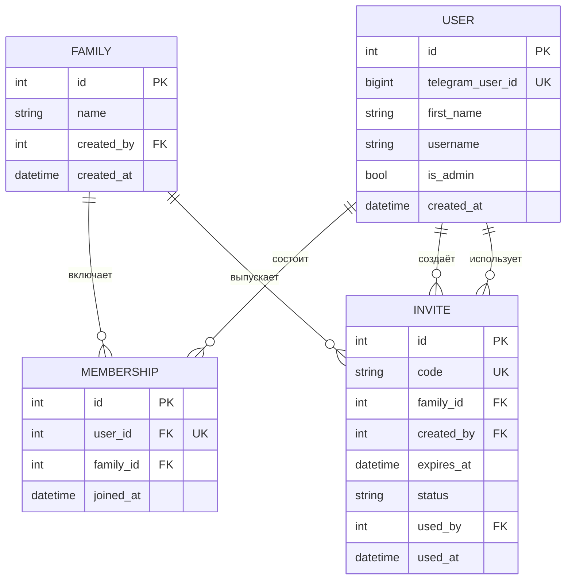
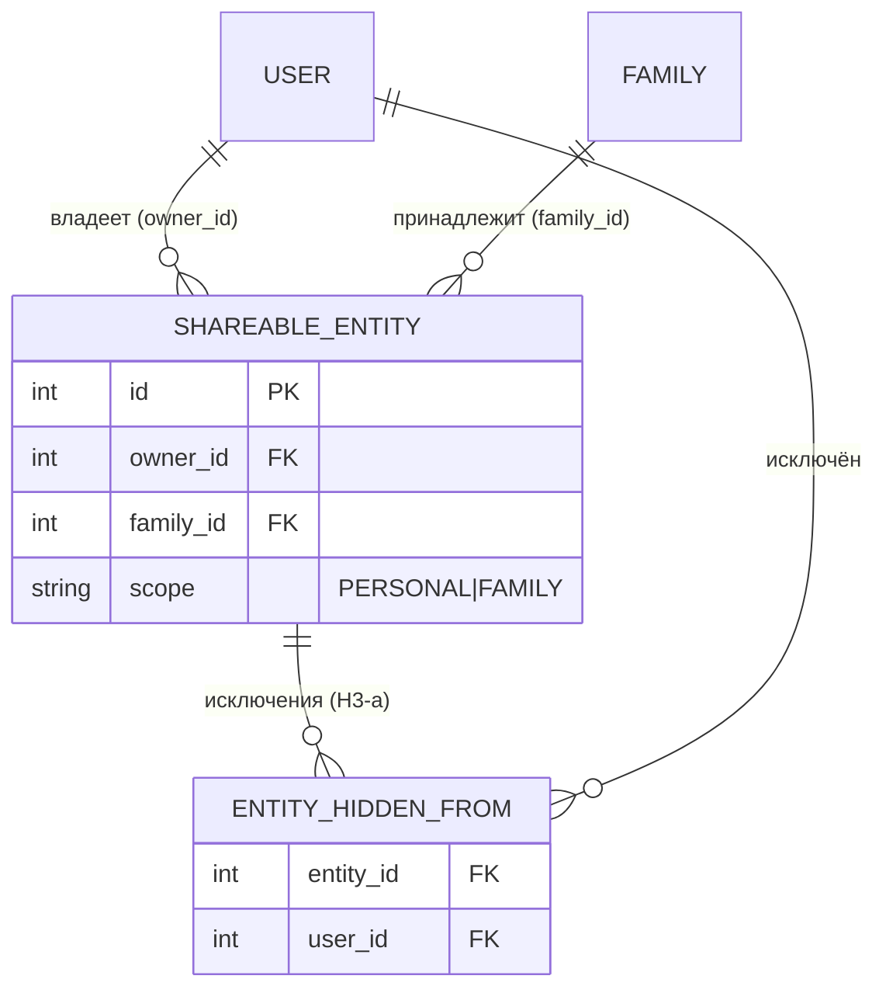
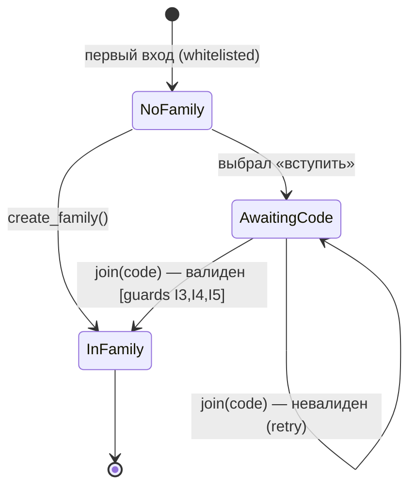

# ТЗ — Identity & Sharing (shared kernel)

**Версия:** 0.5 (принято; учтён аудит F1.1/F2.3)
**Статус:** ✅ Принято (С., 2026-06-06; v0.3–v0.5 — 2026-06-07) — все OQ закрыты
**Дата:** 2026-06-06
**Опирается на:** `MVP_Requirements.md` §1.3/§3.4/§5/§6/§10 · `DOMAIN_MODEL.md` §2/§3.1/§4/§5/§7 · `ADR-0001` (модель видимости, Вариант A + H3) · `ADR-0004` (изоляция контекстов, Вариант B)
**Закрывает:** контекст «Identity & Sharing» доменной модели; action item ADR-0001 №3 (спроектировать `Shareable` + `visible_to`) и ADR-0004 №2 (зафиксировать структуру kernel-пакета).

---

## 1. Назначение и границы контекста

Identity & Sharing — **shared kernel**: единственный контекст, от которого зависят все остальные (DOMAIN_MODEL §2). Отвечает на три вопроса: **кто есть пользователь**, **кто его партнёр (семья)** и **кто что видит** (модель видимости — first-class, центральный шов всей системы).

**Входит в контекст:**
- Идентичность: `User`, `Family`, `Membership`.
- Пейринг: `Invite` (инвайт-код), его жизненный цикл и FSM вступления.
- **Механизм видимости**: миксин `Shareable` (поля `owner_id`/`family_id`/`scope` + множество `hidden_from`) и helper `visible_to(viewer)` — контракт, которому обязана следовать каждая разделяемая сущность всех контекстов.
- Аутентификация Mini App: валидация Telegram `initData` (HMAC), whitelist, резолв текущего зрителя (`viewer`).
- Публичная граница kernel-пакета (что экспортируется наружу; что запрещено импортировать) — операционализация ADR-0004.

**НЕ входит в контекст (намеренно):**
- **Сами разделяемые сущности** (списки, бюджеты, напоминания, дневник) — живут в своих контекстах; kernel задаёт только *контракт* видимости, не владеет данными доменов.
- **Доменные per-user данные** (например, цели КБЖУ) — хранятся в контексте-владельце по `user_id`, **не** колонками на kernel-`User` (изоляция, ADR-0004; см. OQ-4).
- Роли/права/RBAC, несколько семей, >2 участников, внешние не-Telegram пользователи — North Star; явно вне MVP (ADR-0001 «пересмотреть когда»).

**Маппинг на код (вариант C):** существующие `family`/pairing/FSM-инвайт и инфраструктура аутентификации (`initData` HMAC, whitelist, alert админу) — **переиспользуются**; расширяются моделью видимости (новые `scope`/`hidden_from`/`Shareable`/`visible_to`) и переездом управления семьёй в Mini App. Текущая бинарная приватность (`family_id` | `user_id`) **заменяется** унифицированной моделью (данные сносятся, схема greenfield — req §10).

**Дельта target ↔ current-state** (сверено по коду 2026-06-07; вход фазы кода):
- **Invite** ← сейчас одна строка `Family.invite_code` (без статуса/срока/однократности) → строим полноценную сущность (решение С., не упрощаем).
- **Membership** ← сейчас неявное членство через FK `User.family_id` → выделяем в таблицу (решение С., не упрощаем).
- **User**: current — `telegram_id`, `full_name`, `timezone`, `target_kcal/protein/fat/carbs`; КБЖУ-цели переезжают в Nutrition по `user_id` (OQ-4); имена полей приводятся к target при ребилде.
- **Shareable** (`scope`/`hidden_from`/`owner_id`) — в коде отсутствует; шов целиком новый.
- **auth**: `validate_init_data` уже реализует §8 (HMAC, ключ `WebAppData` → msg=token, const-time); поднять default `max_age` 24ч → 30 дней (`web/auth.py:37`).

---

## 2. Глоссарий контекста

- **Viewer (зритель)** — аутентифицированный `User`, от лица которого выполняется запрос; вход любого фильтра видимости.
- **Shareable** — разделяемая сущность: несёт владельца и дескриптор видимости. Реализуется kernel-миксином.
- **scope** — базовый режим видимости сущности: `PERSONAL` | `FAMILY`.
- **hidden_from** — множество `user_id`, исключённых из видимости при `scope=FAMILY` (для подарка — `[одаряемый]`).
- **Пейринг** — связывание двух пользователей в одну `Family` по инвайт-коду.
- Прочие термины — общий глоссарий req §2.

---

## 3. Доменная модель (сущности и атрибуты)

Типы указаны абстрактно (БД-agnostic); конкретика SQLite→Postgres — в kernel, домены агностичны (ADR-0005).

### 3.1 User — пользователь
| Поле | Тип | NULL | Описание / инвариант |
|---|---|---|---|
| `id` | int PK | нет | Внутренний идентификатор. |
| `telegram_user_id` | bigint | нет | Telegram ID. **Unique.** Связь с `initData`. |
| `first_name` | str | нет | Отображаемое имя (из Telegram). |
| `username` | str | да | Telegram @username (может отсутствовать). |
| `is_admin` | bool | нет | Получатель алертов об ошибках (наблюдаемость, req §5). Default `false`. |
| `timezone` | str | нет | IANA-таймзона (default `Europe/Amsterdam`). Есть в current-state; нужна напоминаниям/дайджесту и группировке дневника по дням — кросс-доменный per-user атрибут идентичности. |
| `created_at` | datetime | нет | Момент первого входа (auto-provision). |

> Kernel-`User` несёт **только идентичность**. Доменные per-user данные (цели КБЖУ и т.п.) — в таблицах своих контекстов по `user_id` (ADR-0004; принято OQ-4).

### 3.2 Family — семья (пара)
| Поле | Тип | NULL | Описание / инвариант |
|---|---|---|---|
| `id` | int PK | нет | Идентификатор семьи. |
| `name` | str | да | Необязательное название (default «Наша семья»). |
| `created_by` | FK→User | нет | Кто создал семью. |
| `created_at` | datetime | нет | — |

Инвариант: **≤ 2 активных Membership** на Family в MVP (I1).

### 3.3 Membership — членство
| Поле | Тип | NULL | Описание / инвариант |
|---|---|---|---|
| `id` | int PK | нет | — |
| `user_id` | FK→User | нет | **Unique** — пользователь состоит максимум в одной семье (I2). |
| `family_id` | FK→Family | нет | Unique вместе с `user_id`. |
| `joined_at` | datetime | нет | — |

> Поле `role` намеренно отсутствует — оба партнёра равноправны; роли = North Star (ADR-0001, нет RBAC).

### 3.4 Invite — инвайт-код
| Поле | Тип | NULL | Описание / инвариант |
|---|---|---|---|
| `id` | int PK | нет | — |
| `code` | str | нет | Короткий случайный код. **Unique.** |
| `family_id` | FK→Family | нет | Куда приглашают. |
| `created_by` | FK→User | нет | Автор инвайта. |
| `created_at` | datetime | нет | — |
| `expires_at` | datetime | да | Срок годности (nullable = бессрочно в рамках MVP). |
| `status` | enum | нет | `active` \| `used` \| `expired` \| `revoked`. |
| `used_by` | FK→User | да | Кто использовал (при `used`). |
| `used_at` | datetime | да | Когда использован. |

Инвайт **одноразовый** (I3).

### 3.5 Shareable — контракт видимости (kernel-миксин)
Не отдельная таблица, а набор полей и поведения, **примешиваемый** к каждой разделяемой модели любого контекста.

| Поле | Тип | NULL | Описание / инвариант |
|---|---|---|---|
| `owner_id` | FK→User | нет | Владелец/автор сущности. |
| `family_id` | FK→Family | нет | Семья, которой принадлежит сущность. |
| `scope` | enum | нет | `PERSONAL` \| `FAMILY`. |
| `hidden_from` | множество User | — | Исключения при `FAMILY`; персистенция — H3-a, см. §7. |

> **MVP-допущение:** доменные функции доступны только после пейринга (UI гейтит домены за наличием семьи; система на двоих полезна лишь спаренной), поэтому `family_id` у Shareable всегда заполнен. Разрешение `PERSONAL` зависит только от `owner_id`; `family_id`/`hidden_from` при `PERSONAL` в фильтре не участвуют.

---

## 4. ERD



`Shareable` — миксин на сущностях доменов (Lists/Finance/Nutrition/Reminders), не отдельная таблица; пример разделяемой сущности:



---

## 5. Инварианты и бизнес-правила

**Идентичность и пейринг:**
- **I1.** Семья содержит ≤ 2 активных членства (MVP-cap).
- **I2.** Пользователь состоит максимум в одной семье (`Membership.user_id` unique).
- **I3.** Инвайт одноразовый: переход `active → used` атомарен; повторное использование отклоняется.
- **I4.** Вступление в полную семью (2/2) отклоняется.
- **I5.** Нельзя вступить, уже состоя в семье; нельзя использовать собственный инвайт для вступления в свою же семью.
- **I6.** Только whitelisted-пользователи (`ALLOWED_USER_IDS`) могут аутентифицироваться и быть provisioned.

**Видимость:**
- **I7.** `scope=PERSONAL` ⇒ `hidden_from` пусто (исключения бессмысленны для личного).
- **I8.** `owner_id ∉ hidden_from` (владелец всегда видит своё).
- **I9.** `hidden_from ⊆ члены family` сущности (нельзя исключить не-члена).
- **I10. (тест-инвариант, ADR-0001 §Action №4)** Каждая shareable-модель читается **только** через `visible_to`/базовый репозиторий; чтение в обход фильтра = утечка приватности и не допускается.
- **I11. (import-linter, ADR-0004)** Видимость импортируется доменами только из `kernel`; sibling-context импорты запрещены.

**Разрешение видимости (read) для зрителя `v`:**
```
PERSONAL → виден  ⟺  v == owner_id
FAMILY   → виден  ⟺  v ∈ family(сущности)  И  v ∉ hidden_from
```

**Политика мутаций (принято, OQ-2 — совместное владение):** видимость — необходимое условие любой операции (нельзя изменить невидимое). `PERSONAL` — только владелец (он единственный видит). `FAMILY` без исключений — оба партнёра читают и изменяют (совместное владение). `FAMILY` + `hidden_from` (подарок) — владелец управляет, исключённый не видит и не меняет. Удаление `FAMILY`-сущности по умолчанию доступно любому, кто её видит.

---

## 6. Состояния и переходы — FSM пейринга

Канал создания/вступления — **Mini App (primary, req §5)**; бот сохраняет FSM-вход (`/start`, `/family`) из current-state как точку входа. Логика идентична, оба идут через `pairing_service`.



Гварды перехода `AwaitingCode → InFamily`: инвайт `active` и не просрочен (иначе 410); семья не полна (I4 → 409); пользователь ещё не в семье (I5 → 409). Выход из семьи (`InFamily → NoFamily`) — **вне MVP** (2 пользователя; разрыв семьи ломает все family-данные) → North Star.

---

## 7. Модель видимости в коде (определение механизма)

Kernel предоставляет **миксин `Shareable`** (поля §3.5) и **helper `visible_to(viewer)`**, генерирующий единообразный фильтр; чтения всех контекстов идут через базовый репозиторий, использующий этот helper (не переписывают видимость у себя — снимает риск утечки, I10).

Псевдо-ORM фильтра:
```
visible_to(v):
    PERSONAL:  owner_id == v.id
    FAMILY:    family_id == v.family_id  AND  v.id NOT IN hidden_from(entity)
```

**Персистенция `hidden_from` (H3, ADR-0001) — принято H3-a (С., 2026-06-06):**

**H3-a — ассоциативная таблица на каждую shareable-сущность** (`<entity>_hidden_from(entity_id, user_id)`), объявляется миксином через `declared_attr`. Без полиморфизма и общего PK-пространства; фильтр — `NOT EXISTS` по собственной таблице исключений сущности. Чисто ложится на inline-миксин (Вариант A), минимальная машинерия, согласуется с отказом ADR-0001 от полиморфных ассоциаций; цена — N маленьких таблиц (по одной на тип shareable), на масштабе двух пользователей нерелевантна.

Отклонён **H3-b** (единая `shareable_hidden_from` поверх общей базы `shareable`, joined-table inheritance): централизует «перечислить всё скрытое», но добавляет базовую таблицу + join на каждом shareable-чтении (горячий путь) и по форме ближе к отвергнутому Варианту B. H3-a сохраняет семантику множества и не зашивает «семья = 2» (ради чего С. выбрал H3 вместо JSON).

**Гранулярность (уточнение v0.4):** `scope` и `hidden_from` могут жить на разных уровнях — `scope` на контейнере, `hidden_from` на вложенной сущности; `visible_to` тогда **композируется** (контейнерный фильтр + поэлементный `NOT EXISTS`). Первый случай — ТЗ Lists (`List.scope` + `ListItem.hidden_from`). Миксин остаётся kernel-механизмом; контекст выбирает уровень применения.

---

## 8. Аутентификация и авторизация

**Транспорт:** каждый запрос Mini App несёт `initData` в заголовке (`X-Telegram-Init-Data`). Без cookie/сессий-на-сервере (req §5 — без внешней регистрации/паролей).

**Валидация `initData` (HMAC, current-state переиспользуется):**
1. Секрет = `HMAC_SHA256(key="WebAppData", msg=BOT_TOKEN)`; сверка `hash` по отсортированным парам `data_check_string`.
2. Проверка свежести `auth_date` (max-age = **1 месяц**, принято OQ-3) → защита от replay. Длинное окно — осознанный компромисс в пользу UX (редкая ре-авторизация) при модели угроз из двух whitelisted-пользователей.
3. Парс `user` → `telegram_user_id`.

**Резолв зрителя и whitelist:**
4. `telegram_user_id ∈ ALLOWED_USER_IDS`? Нет → **403**.
5. Маппинг на `User`; при первом входе whitelisted-пользователя — auto-provision (создать `User`).
6. В обработчик передаётся резолвнутый `viewer: User`.

**Коды:** битый/отсутствующий/просроченный `initData` → **401**; не в whitelist → **403**.

**Standalone-шов (req §5, ADR-0004):** доменная логика принимает уже резолвнутого `viewer` и **не знает** о Telegram; вся завязка на `initData` изолирована в `kernel.auth` + `delivery`. Смена аутентификации в будущем не затрагивает домены.

---

## 9. Прикладные сценарии

- **S1. Первый вход.** Whitelisted-пользователь открывает Mini App → `initData` валиден → `User` provisioned → `GET /api/me` отдаёт `{user, family: null}` → UI предлагает создать семью или ввести инвайт.
- **S2. Создание семьи.** `POST /api/family` → создаётся `Family` + `Membership` + активный `Invite` → ответ с кодом для партнёра.
- **S3. Пейринг.** Партнёр (whitelisted) вводит код → `POST /api/family/join {code}` → гварды I3/I4/I5 → `Membership` → семья укомплектована (2/2), инвайт → `used`.
- **S4. Чтение с видимостью.** Любой доменный список читается через базовый репозиторий с `visible_to(viewer)`: личное видит только владелец; family — оба; подарок (`FAMILY`+`hidden_from=[партнёр]`) — виден владельцу, скрыт от одаряемого.
- **S5. Не-член пытается войти.** `initData` валиден, но `telegram_user_id ∉ whitelist` → 403; данные семьи недоступны.

---

## 10. REST-контракт

Все эндпоинты — под `/api/v1`, требуют валидный `initData` (зависимость `current_viewer`), сообщения об ошибках локализованы (ru). Тело — JSON.

| Метод | Путь | Назначение | Запрос | Ответ 200 | Ошибки |
|---|---|---|---|---|---|
| GET | `/api/v1/me` | Текущий пользователь + семья + партнёр | — | `MeDTO` | 401, 403 |
| POST | `/api/v1/family` | Создать семью (если не состоит) | `{name?}` | `FamilyDTO` + `InviteDTO` | 401, 403, 409 (уже в семье) |
| GET | `/api/v1/family` | Семья и её члены | — | `FamilyDTO` | 401, 403, 404 (не в семье) |
| POST | `/api/v1/family/invites` | (Пере)выпустить активный инвайт (старый → `revoked`) | — | `InviteDTO` | 401, 403, 404, 409 (семья полна) |
| POST | `/api/v1/family/join` | Вступить по коду | `{code}` | `FamilyDTO` | 401, 403, 404 (код неизвестен), 409 (уже в семье / семья полна), 410 (просрочен/использован/отозван) |

**Вне MVP (North Star):** выход из семьи, удаление семьи, удаление партнёра, переименование — не реализуются в MVP.

**DTO:**
- `MeDTO` = `{ user: UserDTO, family: FamilyDTO | null }`
- `UserDTO` = `{ id, telegram_user_id, first_name, username, is_admin }`
- `FamilyDTO` = `{ id, name, created_at, members: [MemberDTO] }`
- `MemberDTO` = `{ user_id, first_name, username, joined_at, is_self: bool }`
- `InviteDTO` = `{ code, status, created_at, expires_at }`
- **`VisibilityDTO`** = `{ scope: "personal" | "family", hidden_from: [user_id] }` — **общий DTO** для задания полей `Shareable` в create/update-пейлоадах доменов. Базовая валидация полей — в kernel (нарушение → 422). **Уточнение (v0.5, аудит F1.1):** `scope` и `hidden_from` могут передаваться на **разных уровнях** (Lists: `scope` при создании списка, `hidden_from` — элемента) — единый бандл целиком не обязателен. Правила, зависящие от родителя (I7 «personal⇒hidden_from пуст», I8 «owner∉hidden_from» для вложенной сущности), применяет **сервис контекста** через kernel-хелпер, а не чистый DTO.
- `ErrorDTO` = `{ code: str, message: str (ru) }`

---

## 11. Структура пакета и публичная граница (ADR-0004)

```
app/kernel/
  models/        # User, Family, Membership, Invite; Shareable (миксин)
  sharing/       # visible_to(viewer), базовый репозиторий с фильтром, валидация VisibilityDTO
  auth/          # валидация initData (HMAC), whitelist, зависимость current_viewer
  repositories/  # user_repo, family_repo, invite_repo
  services/      # pairing_service, identity_service
  __init__.py    # публичная поверхность (экспорт наружу)
```

**Публичная поверхность kernel** (что разрешено импортировать контекстам): `User`, `Family`, `Membership`, `Invite`, `Shareable`, `visible_to`, `current_viewer`, `VisibilityDTO`. Внутренние `repositories`/`services`/`auth`-детали — не экспортируются.

**Контракт import-linter (из графа §2):** `contexts.* → kernel` (+ собственный подпакет). Легитимные рёбра (ADR-0004, аудит F2.3): `reminders`/`analytics` → `notifications`; `analytics` → `contexts.*.read`; `reminders`/`analytics` → generic `scheduler`. kernel **не импортирует** `contexts`/`delivery`/`analytics`/`notifications`. Нарушение падает в тесте/pre-commit (ADR-0004, CI пока нет).

---

## 12. Edge-cases и обработка ошибок

- `initData` отсутствует/битый/`auth_date` просрочен → **401** (переоткрыть Mini App).
- Валидный `initData`, пользователь не в whitelist → **403**.
- Whitelisted, первый вход → User auto-provision (не ошибка).
- `POST /family`, когда уже в семье → **409**.
- `join` чужого/своего инвайта, уже состоя в семье → **409** (I5).
- `join` в полную семью (2/2) → **409** (I4).
- `join` по `used`/`expired`/`revoked`/неизвестному коду → **410** / **404**.
- Гонка двух одновременных `join` на последнее место → атомарная проверка (I1/I3) → один успех, второй **409**.
- `VisibilityDTO`: `scope=personal` с непустым `hidden_from` → **422** (I7); `owner ∈ hidden_from` → **422** (I8); `hidden_from` содержит не-члена семьи → **422** (I9).

---

## 13. Нефункциональные аспекты

- **Горячий путь:** `visible_to` применяется почти на каждом чтении всех контекстов — фильтр должен быть одним `WHERE`/`NOT EXISTS` без N join'ов (ADR-0001, драйвер 4). Объём данных крошечный (2 пользователя) — предрасчёт не нужен.
- **Локализация:** все пользовательские сообщения — на русском (req §5).
- **Наблюдаемость:** сохранить алерт админу (`is_admin`) при ошибках (req §5).
- **Портируемость БД:** БД-специфика (`hidden_from`-фильтр) изолирована в `kernel.sharing`; домены агностичны (ADR-0005).
- **Standalone-шов:** домены и kernel-логика Telegram-агностичны; завязка только в `kernel.auth` + `delivery` (ADR-0004, §7 domain).

---

## 14. Критерии приёмки

- **A1.** Два whitelisted-пользователя создают семью и спариваются по инвайту; третий (не в whitelist) получает 403.
- **A2.** Повторное использование инвайта отклонено (I3); вступление в полную семью → 409 (I4); собственный/повторный join → 409 (I5).
- **A3.** `GET /api/me` корректно отражает три состояния: без семьи / создатель / спаренный партнёр.
- **A4.** `initData` с битым `hash` или просроченным `auth_date` → 401; доменная логика вызывается **только** с резолвнутым `viewer` (проверка standalone-шва).
- **A5. (видимость)** Для каждой shareable-модели: запрос с `viewer` возвращает ровно ожидаемое подмножество для `PERSONAL` (только владелец), `FAMILY` (оба) и подарка `FAMILY`+`hidden_from` (владелец видит, исключённый — нет). Чтение в обход `visible_to` отсутствует (тест-инвариант I10).
- **A6. (изоляция)** import-linter: контексты импортируют видимость только из kernel; нарушение падает в тесте/pre-commit (I11, ADR-0004).
- **A7. (валидация видимости)** `VisibilityDTO` отклоняет нарушения I7–I9 кодом 422.

---

## 15. Решённые вопросы

Все вопросы закрыты С. (2026-06-06):

- **OQ-1 — персистенция `hidden_from`:** **H3-a** — ассоциативная таблица на каждую shareable-сущность (`<entity>_hidden_from`), без полиморфизма (см. §7).
- **OQ-2 — мутации `FAMILY`-сущностей:** **совместное владение** — кто видит, тот читает и изменяет; удаление доступно любому видящему (см. §5).
- **OQ-3 — `max-age` для `auth_date`:** **1 месяц** (см. §8).
- **OQ-4 — per-user доменные данные (КБЖУ-цели):** хранятся в Nutrition по `user_id`, не на kernel-`User`; формулировка DOMAIN_MODEL §3.4 синхронизирована.
- **OQ-5 — название семьи / имена партнёров в UI:** оставлены **опциональными** (`Family.name`, `MemberDTO`).

Блокеров для старта write-side (ТЗ Lists) нет.

---

## 16. История изменений
- **0.5 (2026-06-07):** аудит — §10 уточнён (VisibilityDTO: `scope`/`hidden_from` на разных уровнях, валидация с участием сервиса контекста; F1.1); §11 дополнен легитимными рёбрами импортов (reminders/analytics→notifications, analytics→*.read, →scheduler; F2.3).
- **0.4 (2026-06-07):** §7 — уточнение гранулярности: `scope` и `hidden_from` могут жить на разных уровнях (контейнер/элемент), `visible_to` композируется. Драйвер — ТЗ Lists (поэлементное скрытие `ListItem.hidden_from` при `List.scope`).
- **0.3 (2026-06-07):** сверено с current-state кодом (`db/models.py`, `web/auth.py`). Решение С.: Invite-сущность и Membership-таблица оставлены как в ТЗ (не упрощаем к current-state `Family.invite_code` / `User.family_id`). Добавлен `timezone` на User; зафиксирована дельта target↔current (§1) как вход фазы кода; `auth_date` `max_age` 24ч→30д подтверждён по коду.
- **0.2 (2026-06-06):** закрыты все 5 OQ решением С. — H3-a (ассоц-таблица на сущность), совместное владение FAMILY-сущностями, `auth_date` max-age 1 месяц, per-user данные в Nutrition по `user_id`, имена/название семьи опциональны. DOMAIN_MODEL §3.4 синхронизирован. Статус → принято; блокеров для ТЗ Lists нет.
- **0.1 (2026-06-06):** первый черновик ТЗ kernel-контекста. Сведены ADR-0001 (Shareable/visible_to/H3) и ADR-0004 (kernel-пакет, allowed-edges) в реализуемую спецификацию; зафиксированы сущности+атрибуты, ERD, инварианты I1–I11, FSM пейринга, REST-контракт + DTO (вкл. общий `VisibilityDTO`), структура пакета и публичная граница, критерии приёмки A1–A7. Поднято 5 открытых вопросов (OQ-1 персистенция `hidden_from` — ключевой для старта write-side).
