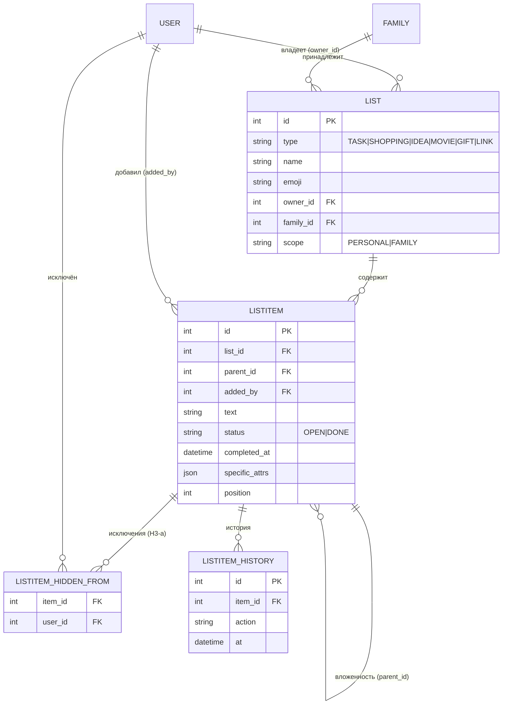
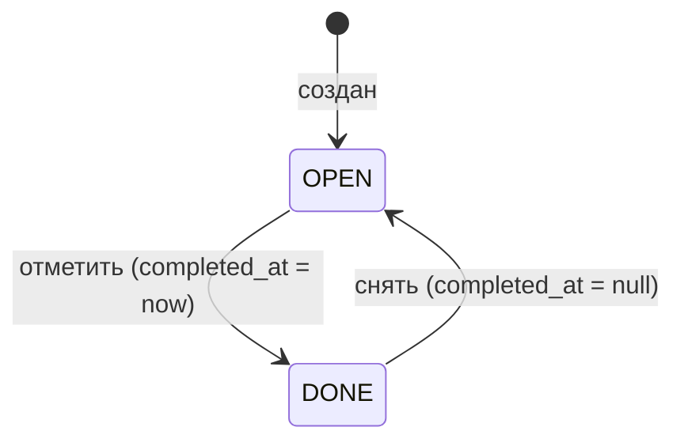

# ТЗ — Lists (типизированные списки)

**Версия:** 0.4 (дельта S3+S4 из MVP-фидбэка партии №1; дефолты С. 2026-06-18)
**Статус:** ✅ Принято v0.4 (С., 2026-06-18); v0.3 — С./Катя 2026-06-07
**Опирается на:** `MVP_Requirements.md` §4.1/§5/§6/§9 · `DOMAIN_MODEL.md` §2/§3.2/§4 · `ADR-0001` (видимость) · `ADR-0004` (изоляция) · `ADR-0005` (SQLite→Postgres) · принятое **ТЗ Identity & Sharing** (`Shareable`, `visible_to`, `VisibilityDTO`, H3-a)
**Закрывает:** контекст «Lists» доменной модели. Первый write-side контекст — **первым применяет `Shareable`**.
**Грунт current-state:** `db/models.py` (`ListCategory`/`ListItem`), `repositories/list_repository.py`, `services/list_service.py`, `handlers/lists.py` (chat-native, REST в Mini App отсутствует).

---

## 1. Назначение и границы контекста

Lists — доменный контекст управления **типизированными списками** с иерархией, метаданными, поиском и аналитикой по типу. Зависит только от kernel. Первый контекст, применяющий шов видимости — на нём проверяется механизм `Shareable` целиком, включая режим скрытия от партнёра.

**Входит:** типизированные списки (6 типов); иерархия вложенности; элементы с метаданными (статус, даты, история, type-специфика); поиск и аналитика по типу (видимость-фильтрованные); приватность через kernel-`Shareable` (личные списки + поэлементное скрытие); REST Mini App (новый) + `read`-модуль для Analytics (ADR-0004).

**НЕ входит:** сам механизм видимости (определён в kernel — здесь применяется); сквозная аналитика/дайджест (контекст Analytics); доставка push (Notifications).

**Маппинг на current-state (вариант C — переработка). Дельта target ↔ current** (сверено по коду 2026-06-07):
- **Типизации нет** → `type` на списке.
- **Список = корневая `ListCategory`** (family-scoped) → выделяем типизированный **`List`** (несёт `scope`).
- **Иерархия `ListCategory.parent_id`** → переносится на самоссылочный `ListItem.parent_id` (узлы-папки + листья в одной сущности; OQ-L4).
- **`ListItem`** (`text`/`is_checked`/`position`) → обрастает `status`/`completed_at`/`hidden_from`/`specific_attrs`/историей.
- **Видимость бинарна (всё family)** → `List.scope` (личный/семейный) + поэлементный `ListItem.hidden_from` (подарки/сюрпризы).
- **Канал — только чат** (FSM `handlers/lists.py`) → переезд в Mini App; chat-FSM ретайрится (req §5).
- Данные greenfield (req §10) — миграции нет; переписываются `repository`/`service`, добавляются `api`/`read`.

---

## 2. Глоссарий контекста
- **List** — типизированный список; единица типа и контейнерной видимости (`scope`). Несёт `Shareable`-`scope`.
- **ListItem** — узел списка: лист (элемент) или папка (узел с детьми). Самоссылочная иерархия. Несёт поэлементный `hidden_from`.
- **Тип списка** — дела / покупки / идеи / фильмы / подарки / ссылки.
- **Статус** — `OPEN` / `DONE` (обобщённый; «посмотрено»/«выполнено» = `DONE`).
- **specific_attrs** — JSON-набор type-специфичных полей элемента (схема на тип валидируется в приложении).
- scope, hidden_from, viewer — см. ТЗ Identity §2.

---

## 3. Принятые решения (чек-поинт OQ-L1…L5, 2026-06-07)
- **L1 — статусы:** общий `OPEN/DONE` в MVP; per-type словарь — North Star.
- **L2 — скрытие:** поэлементное. `hidden_from` живёт на `ListItem`; `scope` (личный/семейный) — на `List` (ADR-0001 «личные списки»). Подарок/сюрприз = элемент с `hidden_from` в любом семейном списке.
- **L3 — история:** lightweight action-лог (без полного field-diff) + кап на хранение (constraint диска VPS).
- **L4 — иерархия:** самоссылочный `ListItem` (папка = узел с детьми), без отдельной таблицы категорий.
- **L5 — type-поля:** один JSON-атрибут `specific_attrs` (не россыпь колонок); схема на тип валидируется в приложении; расширяемо без миграций при добавлении типов.

---

## 4. Доменная модель (сущности и атрибуты)

### 4.1 List — типизированный список (Shareable: scope)
| Поле | Тип | NULL | Описание / инвариант |
|---|---|---|---|
| `id` | int PK | нет | — |
| `type` | enum | нет | `TASK`/`SHOPPING`/`IDEA`/`MOVIE`/`GIFT`/`LINK`. |
| `name` | str | нет | Название. |
| `emoji` | str(2) | да | Иконка (current-state). |
| `owner_id` | FK→User | нет | **Shareable.** Создатель. |
| `family_id` | FK→Family | нет | **Shareable.** Семья. |
| `scope` | enum | нет | **Shareable.** `PERSONAL`/`FAMILY` (default `FAMILY`). Контейнерная видимость. |
| `created_at` | datetime | нет | — |
| `updated_at` | datetime | нет | `onupdate`. |

> `hidden_from` на уровне списка **нет** — скрытие поэлементное (см. `ListItem`). Личный список целиком = `scope=PERSONAL`.

### 4.2 ListItem — узел списка (иерархия + поэлементная видимость)
| Поле | Тип | NULL | Описание / инвариант |
|---|---|---|---|
| `id` | int PK | нет | — |
| `list_id` | FK→List | нет | Список-владелец (источник `scope`/`family`). Index. |
| `parent_id` | FK→ListItem | да | Adjacency List: NULL = верхний уровень; иначе — вложен. `ondelete=CASCADE`. Index. |
| `added_by` | FK→User | нет | Автор = владелец элемента (всегда видит своё; `added_by ∉ hidden_from`). |
| `text` | text | нет | Содержимое. |
| `status` | enum | нет | `OPEN`/`DONE`. Default `OPEN`. |
| `completed_at` | datetime | да | Заполнен ⟺ `DONE` (I4). |
| `hidden_from` | множество User | — | **Shareable** (H3-a: `list_item_hidden_from`). Скрытие от партнёра в семейном списке. |
| `specific_attrs` | JSON | да | Type-специфичные поля (url, цена, рейтинг…). Схема на тип — в приложении (I5). SQLite JSON1 → Postgres JSONB (ADR-0005). |
| `position` | int | нет | Порядок в пределах родителя (current-state). |
| `created_at` | datetime | нет | — |
| `updated_at` | datetime | нет | `onupdate`. |

> Папка = `ListItem` с детьми; лист = без. У папок `status` игнорируется/агрегируется в UI. Глубина ≤ `max_depth` (10, current-state).

### 4.3 ListItemHistory — история (lightweight action-лог)
| Поле | Тип | NULL | Описание |
|---|---|---|---|
| `id` | int PK | нет | — |
| `item_id` | FK→ListItem | нет | `ondelete=CASCADE`. Index. |
| `user_id` | FK→User | нет | Кто изменил. |
| `action` | enum | нет | `CREATED`/`EDITED`/`STATUS_CHANGED`/`MOVED`. |
| `detail` | str | да | Кратко (например, `OPEN→DONE`). |
| `at` | datetime | нет | — |

> **Кап хранения (L3, уточнено Q1-А7):** count-cap — **последние 50 событий на элемент** (`HISTORY_CAP=50`, module-константа репозитория, не конфиг); inline-обрезка при каждой вставке, фоновой подметалки нет. Полный field-diff не пишем. Соответствует реализации S2a (`test_history_is_capped`).

### 4.4 list_item_hidden_from — исключения видимости (H3-a)
| Поле | Тип | NULL | Описание |
|---|---|---|---|
| `item_id` | FK→ListItem | нет | PK вместе с `user_id`. `ondelete=CASCADE`. |
| `user_id` | FK→User | нет | Исключённый зритель. |

H3-a-ассоциация (kernel), применённая к `ListItem`. `hidden_from` нормализован (горячий путь — фильтр на каждом чтении), в отличие от JSON-`specific_attrs` (холодные данные).

---

### 4.5 Реестр `specific_attrs` по типам (I5, v0.4)

Изменённые типы v0.4:

| Тип | Ключи | Заметки |
|---|---|---|
| `TASK` (дела) | `due_date?`, `priority?`, `tags?` | **v0.4:** `priority` — enum `{LOW, MEDIUM, HIGH, URGENT, CRITICAL}` (5 уровней) вместо свободного текста; пусто = без приоритета. UI-лейблы ru: низкий / средний / высокий / срочный / «ВОТПРЯМЩАССРОЧНОСУКА» (рабочий лейбл — UI-копи, правится без миграции). `due_date` = Срок. |
| `LINK` (ссылки) | `url`, `comment?`, `tags?` | **v0.4:** первичное поле `ListItem.text` = **Заголовок** (UI-релейбл); `comment` = текст/комментарий (заменил прежний link-`title`). Кликабельная подпись = `text`, href = `url`. |

Прочие типы (`SHOPPING`/`IDEA`/`MOVIE`/`GIFT`) — без изменений v0.4; `tags?` доступен для `GIFT`/`IDEA`/`LINK` (Q1-А9). Enum-значения `priority` стабильны (код/БД); отображаемые лейблы — UI-копи. Добавление ключей миграции не требует (JSON, I5).

---

## 5. ERD



---

## 6. Инварианты и бизнес-правила
- **I1.** `List` несёт `scope`; чтения идут через `visible_to` (kernel I10). Видимость **композируется**: контейнер (`List.scope`) + элемент (`ListItem.hidden_from`).
- **I2.** `ListItem.list_id` совпадает с `list_id` родителя: вложение только внутри одного списка.
- **I3.** Дерево `ListItem` ацикличное; глубина ≤ `max_depth` (10).
- **I4.** `status=DONE` ⟺ `completed_at` заполнен.
- **I5.** `specific_attrs` валидируется против схемы на `List.type` в приложении (реестр допустимых ключей/типов); неизвестные ключи отклоняются. Жёсткой БД-схемы нет (расширяемость под новые типы без миграций). Реестр включает ключ `tags: [str]` для `GIFT`/`IDEA`/`LINK` (Q1-А9); кросс-типовой тег-фильтр — North Star. **Полный реестр по типам — §4.5** (v0.4: LINK получает `comment`, TASK — `priority`-enum).
- **I6.** Удаление `List` каскадит элементы, историю, `list_item_hidden_from`. Удаление папки каскадит детей.
- **I7. (наследование видимости)** `ListItem`/история own-`scope` не несут; `hidden_from` элемента учитывается только когда его `List.scope=FAMILY` (в `PERSONAL`-списке исключения бессмысленны).
- **I8.** `added_by ∉ hidden_from` (владелец элемента всегда видит своё); `hidden_from ⊆ члены family` списка.
- **I9. (мутации, kernel OQ-2 «совместное владение»)** Кто видит элемент — читает и изменяет его; исключённый не видит → не меняет.

**Разрешение видимости для зрителя `v`:**
```
Список (для выдачи списков):
  PERSONAL → v == List.owner_id
  FAMILY   → v ∈ family

Элемент (для содержимого):
  List.scope=PERSONAL → v == List.owner_id
  List.scope=FAMILY   → v ∈ family  И  v ∉ ListItem.hidden_from
```

---

## 7. Модель видимости в контексте

Первое применение kernel-`Shareable`, в **двухуровневой** форме (kernel §7 допускает разную гранулярность `scope` и `hidden_from`):

- **`List.scope` (контейнер):** `PERSONAL` — список целиком только владельцу («личные списки», ADR-0001); `FAMILY` — оба партнёра видят список.
- **`ListItem.hidden_from` (элемент):** в семейном списке отдельные элементы скрываются от партнёра. Подарок/сюрприз = элемент с `hidden_from=[партнёр]`.

`visible_to` композируется: контейнерный фильтр по `List.scope` + поэлементный `NOT EXISTS` по `list_item_hidden_from` (H3-a). Видимость задаётся `VisibilityDTO` на нужном уровне (scope — при create/update списка; hidden_from — при create/update элемента); kernel валидирует.

**Кейсы скрытия:**
- Точечно: общий список «Идеи», один элемент скрыт от партнёра → партнёр видит список, но не этот элемент.
- Целиком приватно: `scope=PERSONAL` — партнёр не видит даже название списка.
- Список «Подарки» как `FAMILY` со всеми элементами `hidden_from=[партнёр]` → партнёр видит пустой список (название видно). Нужно скрыть и название — делать `PERSONAL`.

---

## 8. Состояния и переходы

**Статус элемента:**

Каждый переход пишет `ListItemHistory(action=STATUS_CHANGED)`.

**Канал:** редактирование — Mini App (CRUD по REST, без серверного FSM). Chat-FSM current-state ретайрится; бот — вход + push (req §5).

---

## 9. Прикладные сценарии
- **S1.** Создать список: `POST /lists {type, name, scope}` → `List`.
- **S2.** Иерархия: внутри «Фильмы» — узлы-папки «Фантастика › Фэнтези», в них элементы; breadcrumb по `parent_id`.
- **S3.** Отметить: `PATCH /items/{id} {status:DONE}` → `completed_at=now` + история.
- **S4.** Скрыть подарок: в общий список добавить элемент с `hidden_from=[партнёр]` → партнёр элемент не видит (выдача/поиск/аналитика), владелец видит.
- **S5.** Поиск: `GET /lists/search?q=` → элементы из видимых списков (минус скрытые) **и сами списки по совпадению названия** (Q1-А8).
- **S6.** Аналитика: `GET /lists/analytics?type=MOVIE&from=&to=` → число `DONE` за период (видимость учтена).

---

## 10. REST-контракт

Под `/api/v1`, аутентификация — kernel `current_viewer`; все выборки visibility-фильтрованы; ru.

| Метод | Путь | Назначение | Запрос | Ответ | Ошибки |
|---|---|---|---|---|---|
| GET | `/lists` | Видимые списки (опц. `?type=`) | — | `[ListDTO]` | 401,403 |
| POST | `/lists` | Создать список | `{type,name,emoji?,scope?}` | `ListDTO` | 401,403,422 |
| GET | `/lists/{id}` | Список + дерево элементов | — | `ListDetailDTO` | 401,403,404 |
| PATCH | `/lists/{id}` | Имя/иконка/scope | `{name?,emoji?,scope?}` | `ListDTO` | 401,403,404,422 |
| DELETE | `/lists/{id}` | Удалить (каскад) | — | `204` | 401,403,404 |
| POST | `/lists/{id}/items` | Добавить элемент/папку | `{text,parent_id?,specific_attrs?,hidden_from?}` | `ItemDTO` | 401,403,404,422 |
| PATCH | `/items/{id}` | Текст/статус/attrs/скрытие/перенос | `{text?,status?,specific_attrs?,hidden_from?,parent_id?}` | `ItemDTO` | 401,403,404,422 |
| DELETE | `/items/{id}` | Удалить (каскад детей) | — | `204` | 401,403,404 |
| POST | `/lists/{id}/clear-done` | Удалить отмеченные | — | `{deleted:int}` | 401,403,404 |
| GET | `/lists/search` | Поиск по видимым элементам и названиям списков | `?q=` | `[SearchHitDTO]` | 401,403 |
| GET | `/lists/analytics` | Аналитика по типу | `?type=&from=&to=` | `ListAnalyticsDTO` | 401,403,422 |
| GET | `/items/{id}/history` | История элемента | — | `[HistoryDTO]` | 401,403,404 |

**DTO:**
- `ListDTO` = `{id, type, name, emoji, scope, counts:{open,done}, created_at}` (counts — для зрителя, скрытые элементы исключены).
- `ListDetailDTO` = `ListDTO` + `{items:[ItemDTO]}` (дерево через `parent_id`).
- `ItemDTO` = `{id, list_id, parent_id, text, status, completed_at, specific_attrs, hidden_from:[user_id], position, added_by, created_at, updated_at}`.
- `SearchHitDTO` = `{kind:"item"|"list", item?:ItemDTO, list:{id,type,name}}` — item-хит несёт `item`+`list`; list-хит (совпадение названия, Q1-А8) — только `list`.
- `ListAnalyticsDTO` = `{type, from, to, total, done, by_period:[{period,done}]}`.
- `HistoryDTO` = `{action, detail, user_id, at}`.
- `scope` задаётся через kernel-`VisibilityDTO` (контейнер), `hidden_from` — поэлементно.

---

## 11. Аутентификация и авторизация
- Аутентификация — целиком kernel (`current_viewer` по `initData`).
- Авторизация = композированная видимость (§6). Мутации — kernel OQ-2 («совместное владение»): кто видит элемент, тот его меняет; исключённый из `hidden_from` не видит и не меняет.
- Standalone-шов: сервисы Lists принимают резолвнутого `viewer`, Telegram-агностичны (ADR-0004).

---

## 12. Структура пакета и публичная граница (ADR-0004)

```
app/contexts/lists/
  models/         # List, ListItem, ListItemHistory (+ Shareable из kernel)
  repositories/   # list_repo (дерево, поиск, JSON-доступ изолирован), item_repo
  services/       # list_service (visible_to, история, валидация specific_attrs по type)
  api/            # REST Mini App (/api/v1/lists, /items)
  read/           # visibility-фильтрованные проекции для Analytics: counts по type/status/период + recent-changes (added/done за период по полям ListItem — Q1-А10; history не источник)
```

**Импорты (import-linter, граф §2):** `contexts.lists → только kernel`; sibling-контексты не импортируются; `analytics` читает только `contexts.lists.read`; `delivery` зовёт `lists.api`/`services`, Lists не импортирует `delivery`. БД-специфика JSON-доступа (`specific_attrs`) изолирована в `repositories` (ADR-0005).

---

## 13. Edge-cases и обработка ошибок
- `parent_id` из другого списка → **422** (I2); превышение глубины → **422** (I3).
- `specific_attrs` с ключом вне схемы типа → **422** (I5).
- Обращение к скрытому от зрителя элементу (`GET/PATCH/DELETE /items/{id}`) → **404** (существование скрыто); скрытый `PERSONAL`-список → **404**.
- Поиск/аналитика не возвращают невидимые зрителю элементы.
- `hidden_from` в `PERSONAL`-списке / с `added_by` / с не-членом → **422** (I7/I8).
- Удаление — каскад (элементы, история, `list_item_hidden_from`).
- `clear-done` удаляет только **видимые зрителю** DONE-элементы; скрытые от него не затрагиваются (Q1-А6).

---

## 14. Нефункциональные аспекты
- **Горячий путь:** `visible_to` на каждом чтении — `WHERE` по `List.scope` + `NOT EXISTS` по `list_item_hidden_from` (H3-a, нормализовано). `specific_attrs` (JSON) в фильтрах горячего пути не участвует.
- **Поиск/аналитика:** on-the-fly (`LIKE`/`COUNT GROUP BY`); предрасчёта нет (req §9). Поиск `LIKE` портируем SQLite/Postgres; FTS-абстракция (ADR-0005 action#2) осознанно отложена в North Star — объём крошечный (аудит F4.4).
- **История:** капится под диск VPS (L3).
- **Локализация:** ru. **Standalone-шов:** домен Telegram-агностичен.

---

## 15. Критерии приёмки
- **A1.** CRUD типизированного списка/элементов через REST; иерархия и breadcrumb сохраняются.
- **A2. (первый Shareable)** Элемент с `hidden_from=[партнёр]` не виден исключённому в выдаче, `GET /items/{id}` (404), поиске и аналитике; виден владельцу. `PERSONAL`-список не виден партнёру целиком. Переиспользует kernel-тест видимости.
- **A3.** `status=DONE` ⟺ `completed_at`; переход пишет историю; история не превышает кап.
- **A4.** Вложение между списками и превышение глубины → 422; `specific_attrs` валидируется по типу.
- **A5.** Аналитика по типу считает только `DONE` из видимых зрителю элементов.
- **A6. (изоляция)** Analytics берёт данные только через `contexts.lists.read`; прямой импорт падает в import-linter.
- **A7. (поиск, Q1-А8)** `/lists/search` возвращает и элементы, и списки по совпадению названия (`kind:"list"`); видимость соблюдена. *(Дельта к S2a-коду — проверить/доделать на приёмке.)*

---

## 16. Решённые вопросы (OQ-L1…L5, закрыты 2026-06-07)
- **OQ-L1** — статусы: общий `OPEN/DONE`; per-type — North Star.
- **OQ-L2** — скрытие поэлементное: `hidden_from` на `ListItem`, `scope` на `List`.
- **OQ-L3** — история: lightweight action-лог + кап хранения.
- **OQ-L4** — иерархия: самоссылочный `ListItem`.
- **OQ-L5** — type-поля: один JSON `specific_attrs` + валидация схемы на тип в приложении (расширяемо без миграций).
- **OQ-L6 (v0.4)** — поля типа LINK: `item.text` = Заголовок; `comment` вместо прежнего link-title (дефолт С., 2026-06-18).
- **OQ-L7 (v0.4)** — приоритет TASK: enum из 5 уровней (LOW/MEDIUM/HIGH/URGENT/CRITICAL); отображаемые лейблы — UI-копи.

Блокеров нет.

---

## 17. История изменений
- **0.4 (2026-06-18):** дельта по MVP-фидбэку партии №1. **S3** — тип LINK: первичное поле `item.text` = Заголовок (UI-релейбл), `specific_attrs` LINK = `{url, comment?, tags?}` (link-`title` заменён на `comment`); кликабельный рендер по `url`. **S4** — тип TASK: `priority` стал enum из 5 уровней `{LOW,MEDIUM,HIGH,URGENT,CRITICAL}` вместо свободного текста. Добавлен §4.5 (реестр specific_attrs по типам). **Миграции нет** (JSON, схема в приложении); осиротевший LINK-`title` бэкфиллится в `comment`. OQ-L6/L7 закрыты.
- **0.3 (2026-06-10):** влиты решения Q1 (С.): кап истории = count-cap 50/элемент, как в S2a (А7); поиск включает названия списков — `SearchHitDTO.kind`, критерий A7 (А8); `tags` в реестре `specific_attrs` для GIFT/IDEA/LINK (А9); clear-done — только видимые зрителю (А6); read-модуль отдаёт recent-changes по полям ListItem для дайджеста (А10/CH-5).
- **0.2 (2026-06-07):** закрыты OQ-L1…L5. Скрытие переведено на уровень элемента (`ListItem.hidden_from`, `list_item_hidden_from`), `scope` оставлен на `List` (личные списки); type-поля — единый JSON `specific_attrs` с валидацией схемы на тип (вместо колонок); история — action-лог с капом. Видимость стала двухуровневой (контейнер + элемент); ERD/инварианты/REST/DTO/edge обновлены. Статус → принято.
- **0.1 (2026-06-07):** первый черновик ТЗ Lists (модель, ERD, инварианты, статус-FSM, REST, структура пакета, критерии приёмки, 5 OQ).
