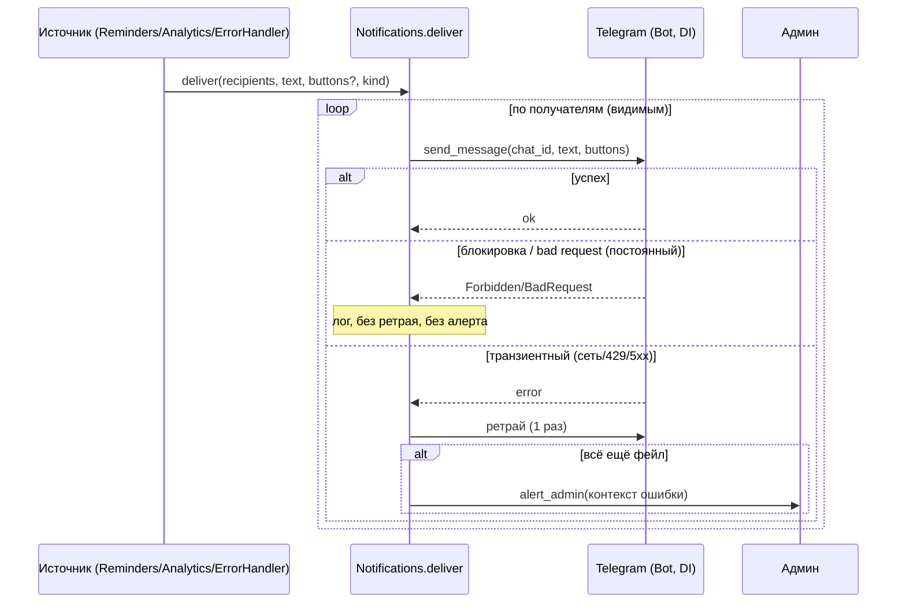

# ТЗ — Notifications / Delivery (исходящий шов)

**Версия:** 0.3 (принято; Q1-А5/Б3 влиты)
**Статус:** ✅ Принято (С./Катя, 2026-06-07)
**Дата:** 2026-06-07
**Опирается на:** `MVP_Requirements.md` §5 · `DOMAIN_MODEL.md` §2/§3.7/§7 · `ADR-0003` (недоставка: лог→ретрай→алерт админу) · `ADR-0004` (изоляция; `delivery`-шов под standalone)
**Закрывает:** контекст «Notifications / Delivery» + action item ADR-0003 №4 (ретрай доставки + алерт админу).
**Грунт:** существующие `services/notification_service.py` (отправка с обработкой блокировки бота, DI `Bot`) и `bot.py` (`@dp.error()` → алерт админу по `admin_telegram_id`) — **переиспользуются**. DOMAIN_MODEL §3.7.

---

## 1. Назначение и границы контекста

Notifications — **supporting-контекст**: единственный исходящий шов в Telegram. Принимает от других контекстов запрос «доставить сообщение получателям» и выполняет его с единой политикой (ретрай + алерт админу при стойком фейле). Изолирует Telegram от доменов (standalone-шов, ADR-0004): домены формируют **что** и **кому**, Notifications — **как доставить**.

**Входит:** интерфейс доставки (`deliver`/`alert_admin`); резолв получателей (через kernel); политика недоставки (лог → ретрай → алерт, ADR-0003); обработка ошибок Telegram (блокировка бота, bad request, транзиентные); инлайн-кнопки в push (ack/snooze) и маршрутизация их callback'ов к контекстам-источникам.

**НЕ входит:** **что** и **когда** уведомлять (это контексты-источники: Reminders — срабатывания, Analytics — дайджест, error-handler — алерты, опц. Lists — изменения); композиция дайджеста (Analytics); инбаунд (команды/Mini App — `delivery/bot`).

**Маппинг:** переиспользуется механика `notification_service` (отправка + обработка блокировки) и `@dp.error()`-алерт; обобщается до единого `deliver` с политикой ретрая (новое из ADR-0003) и поддержкой инлайн-кнопок (новое — под reminders).

---

## 2. Глоссарий контекста
- **Доставка (delivery)** — отправка одного сообщения одному получателю в Telegram.
- **Источник** — контекст, инициирующий уведомление (Reminders / Analytics / error-handler / Lists).
- **Получатель** — `User` (резолвится в `telegram_id`).
- **Алерт админу** — служебное сообщение об ошибке на `admin_telegram_id`.
- **Транзиентный / постоянный фейл** — временная ошибка (ретрай) / блокировка бота, bad request (без ретрая).

---

## 3. Модель (stateless)

В MVP Notifications **не имеет своей БД-сущности** — это **сервис доставки без состояния**. Состояние, требующее персистентности, живёт у источников (`Reminder.next_fire_at`/`status` — ADR-0003). Доставка — **best-effort синхронная** (в общем event-loop): попытка + один ретрай; стойкий фейл → алерт админу. Перевод на **durable-очередь — явный следующий шаг после MVP** (решено No2): синхронно сейчас, очереди потом.

> Журнала доставок в MVP нет (как и журнала срабатываний у Reminders) — не плодим хранилище под объём на двоих.

---

## 4. Поток доставки



---

## 5. Политика доставки (ADR-0003)

| Исход | Действие |
|---|---|
| Успех | Готово. |
| **Блокировка бота** (`TelegramForbiddenError`) | Лог (warning). **Без ретрая и без алерта** — ожидаемое действие пользователя. |
| **Bad request** (`TelegramBadRequest`) | Лог. Без ретрая (запрос некорректен); алерт админу, если неожиданно. |
| **Транзиентный** (сеть/таймаут/429/5xx) | **Один ретрай** (короткая задержка); если снова фейл → **алерт админу** (`admin_telegram_id`). |
| Несколько получателей | Фейл одного **не прерывает** доставку остальным. |

Алерт админу переиспользует существующий путь (`@dp.error()` уже шлёт трейсбеки на `admin_telegram_id`); тот же канал — для стойких фейлов доставки.

---

## 6. Инварианты
- **I1. (единственный шов)** Notifications — **единственное** место исходящей отправки в Telegram; домены `Bot` напрямую не зовут (standalone-шов, ADR-0004).
- **I2. (видимость)** уведомление не отправляется получателю про то, что **скрыто** от него: источник резолвит получателей через `visible_to` **до** вызова `deliver` (напр. изменение скрытого подарка не пушится исключённому партнёру).
- **I3. (best-effort)** доставка не гарантирована и не дублируется в рамках одного события: источник продвигает своё состояние один раз (Reminder advance), Notifications делает попытку + один ретрай.
- **I4. (без шторма)** блокировка/постоянный фейл не ретраятся; алерт админу шлётся только на стойкие транзиентные фейлы; неудача самого алерта — только лог (не зацикливаемся).
- **I5. (DI-транспорт)** `Bot` передаётся в Notifications снаружи (композиция в `main.py`); сервис не импортирует bot-инстанс из хендлеров.

---

## 7. Источники уведомлений

| Источник | Триггер | Содержимое | Кнопки |
|---|---|---|---|
| **Reminders** | срабатывание (`next_fire_at`) | текст напоминания | `✅ Выполнено` · `⏰ Отложить 1 ч` |
| **Analytics** | периодическая job (каденс — Катя) | ретро-дайджест (композиция Analytics) | — |
| **Error-handler** | необработанное исключение | тип/сообщение/трейсбек | — |
| **Lists** (OQ-No1; матрица — Q1-Б3) | элемент: **добавлен / отмечен DONE / перенесён / удалён**; список: **создан / удалён**. Правка текста — **не шлётся** (шум). | «партнёр изменил X» | — |

Получатели по `scope`: `PERSONAL` → владелец; `FAMILY` → оба (минус актор для change-уведомлений; минус исключённые `hidden_from`, I2).

**Маршрутизация callback'ов:** инлайн-кнопки несут payload (`rem:ack:{id}` / `rem:snooze:{id}`); нажатие приходит в `delivery/bot`, который диспетчит в сервис источника (Reminders ack/snooze). Notifications формирует кнопки, бот маршрутизирует ответ.

---

## 8. Сервисный интерфейс (внутренний, не REST)

Notifications не имеет Mini App REST — это внутренний сервис, вызываемый контекстами.

- `deliver(recipients: list[User], text: str, *, buttons: list[Button] | None = None, kind: str) -> DeliveryReport` — доставить с политикой §5.
- `alert_admin(text: str) -> None` — служебный алерт на `admin_telegram_id` (no-op, если не задан).
- `DeliveryReport = { sent: int, blocked: int, failed: int }` — для лога/диагностики (не персистится).

Резолв получателей — через kernel (`family`-члены, `visible_to`); Notifications принимает уже резолвнутый список `User` либо хелпер из kernel.

---

## 9. Структура пакета и публичная граница (ADR-0004)

```
app/notifications/
  service.py      # deliver(), alert_admin(); политика ретрая/ошибок
  recipients.py   # резолв получателей по scope/family (через kernel)
```
**Импорты:** `notifications → kernel` (+ aiogram `Bot` как транспорт через DI). **Импортируется** `reminders`, `analytics`, `delivery`, глобальным error-handler. Notifications **не импортирует** контексты/`delivery` (supporting-слой). Домены `Bot` напрямую не зовут — только через Notifications (I1).

---

## 10. Edge-cases и обработка ошибок
- **Один партнёр заблокировал бота** → второму доставлено; первому — лог, без ретрая/алерта (I4).
- **Транзиентная ошибка** → один ретрай; стойко → алерт админу.
- **Сам алерт админу не ушёл** → только лог (без цикла, I4).
- **`admin_telegram_id` не задан** → алерты only-log.
- **Callback по уже закрытому напоминанию** (ack/snooze, reminder `DONE`/удалён) → no-op + короткий ответ пользователю.
- **Изменение скрытого элемента** → исключённый получатель не уведомляется (I2).
- **Дайджест/напоминание частично не доставлено** → остальным доставлено; фейлы по политике §5.
- **Сообщение длиннее лимита Telegram (4096)** → усечение по строкам/секциям с хвостом «…и ещё N»; на несколько сообщений не разбиваем (Q1-А5).

---

## 11. Нефункциональные аспекты
- **Один процесс/loop** — доставка синхронна в общем event-loop (без брокеров/очередей, frozen §5).
- **Standalone-шов** — Telegram заперт в Notifications + `delivery`; домены агностичны (ADR-0004).
- **Наблюдаемость** — сохранён алерт админу (req §5); фейлы логируются.
- Объём крошечный; локализация ru.

---

## 12. Критерии приёмки
- **A1.** Push напоминания доставляется получателям по `scope` с кнопками ack/snooze; нажатие маршрутизируется в Reminders.
- **A2. (политика)** транзиентный фейл → один ретрай → стойко → алерт админу; блокировка бота → лог без ретрая/алерта.
- **A3. (видимость)** получатель не уведомляется про скрытый от него элемент (I2).
- **A4. (единственный шов)** домены не импортируют `Bot`/aiogram напрямую — только через Notifications (import-linter); Notifications — единственная исходящая точка.
- **A5.** алерт админу об ошибках работает (переиспользует `@dp.error()`-путь); неудача алерта не зацикливается.

---

## 13. Решённые вопросы (закрыты С./Катя, 2026-06-07)
- **OQ-No1 — real-time change-уведомления:** **сохраняем** (current-state «партнёр изменил X»), строго с учётом видимости (I2); пересечение с ретро-дайджестом допустимо.
- **OQ-No2 — durable-доставка:** **best-effort синхронно** в MVP; перевод на durable-очередь — **явный следующий шаг после MVP** (North Star).

> Решено инлайн (ADR-0003): политика недоставки — лог → один ретрай → алерт админу; stateless-доставка, без журнала.

---

## 14. История изменений
- **0.3 (2026-06-10):** влиты решения Q1: матрица change-уведомлений Lists — добавлен/DONE/перенесён/удалён + создание/удаление списка, правка текста не шлётся (Б3); сообщения >4096 — усечение «…и ещё N», без разбивки (А5).
- **0.2 (2026-06-07):** закрыты OQ-No1/No2 — real-time change-уведомления сохранены (с учётом видимости); доставка best-effort синхронно в MVP, durable-очередь — следующий шаг после MVP. Статус → принято.
- **0.1 (2026-06-07):** первый черновик ТЗ Notifications. Зафиксированы: supporting-роль (единственный исходящий Telegram-шов), stateless best-effort доставка, политика недоставки (лог→ретрай→алерт, ADR-0003), обработка ошибок Telegram (блокировка/bad request/транзиент), инлайн-кнопки + маршрутизация callback'ов, источники (Reminders/Analytics/error/Lists), сервисный интерфейс, структура пакета, инварианты I1–I5, критерии A1–A5. 2 OQ (real-time change-уведомления — Катя; durable-доставка — North Star).
