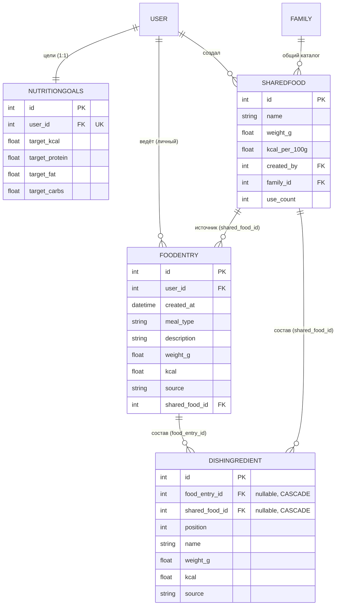
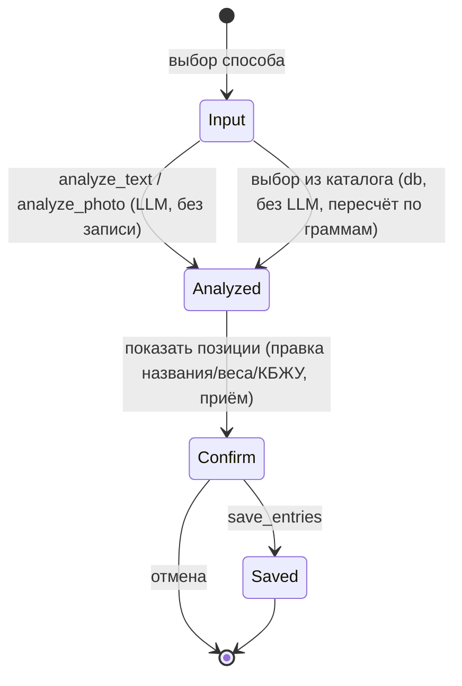

# ТЗ — Nutrition (дневник питания)

**Версия:** 0.2.3 (принято; +инкременты 0.2.1/0.2.2; поле `source` = провенанс ADR-0013)
**Статус:** ✅ Принято (С./Катя, 2026-06-07)
**Дата:** 2026-06-07
**Опирается на:** `MVP_Requirements.md` §3.3/§4.3/§5 · `DOMAIN_MODEL.md` §2/§3.4/§4 · `ADR-0004` (изоляция) · `ADR-0005` (SQLite→Postgres) · ТЗ Identity (`Shareable`, `scope`, `User.timezone`, OQ-4)
**Закрывает:** контекст «Nutrition» доменной модели.
**Грунт:** `lifeManager_bot/food_module.md` + код модуля еды (`db/models.py`, `services/food_service.py`, `services/llm_service.py`, `web/api.py`, `repositories/food_repository.py`, `repositories/shared_food_repository.py`) — **открыты и сверены 2026-06-07**.

---

## 1. Назначение и границы контекста

Nutrition — дневник питания с расчётом КБЖУ: ввод (текст/фото/база), цели, история, выгрузка за период, общий каталог блюд. **Самый зрелый контекст** — реализован и проверен; ТЗ **фиксирует существующее** и описывает **дельту под kernel** (вариант C — «переиспользуется почти как есть», DOMAIN_MODEL §3.4).

**Входит:** личный дневник (`FoodEntry`), общий каталог блюд (`SharedFood`), цели КБЖУ (per-user), 3 способа ввода с LLM-разбором (Groq), дневной экран (прогресс-бары + группировка по приёмам), история, markdown-выгрузка за период; REST Mini App; `read`-модуль для Analytics.

**НЕ входит:** напоминания о приёмах/витаминах (контекст Reminders — generic, DOMAIN_MODEL §3.5); сквозной дайджест (Analytics); медблок/тренировки/интеграции (North Star, req §8).

**Особенность — двойная приватность внутри контекста** (DOMAIN_MODEL §3.4): дневник **личный** (`PERSONAL`), каталог блюд **общий** (`FAMILY`).

**Маппинг:** backend (модель, репозитории, сервисы, LLM, REST, фронт Mini App) **переиспользуется**. Меняется немного — см. §3.

---

## 2. Глоссарий контекста
- **FoodEntry** — запись дневника: один приём/продукт с КБЖУ за порцию. Личная.
- **SharedFood** — блюдо общего каталога: КБЖУ на 100 г + стандартная порция. Общее.
- **NutritionGoals** — дневные цели КБЖУ пользователя (ккал/Б/Ж/У).
- **Приём пищи (meal_type)** — завтрак/обед/ужин/перекус (авто по времени, переопределяемо).
- **analyze vs save** — разбор (только счёт, без записи) и сохранение (после подтверждения в UI).
- scope, viewer — см. ТЗ Identity.

---

## 3. Дельта target ↔ current-state (вариант C)

Сверено по коду 2026-06-07. Большая часть — **без изменений**.

- **Цели КБЖУ:** сейчас на `User` (`target_kcal/protein/fat/carbs`) → переезжают в Nutrition-сущность `NutritionGoals` по `user_id` (kernel OQ-4). `/api/goals` читает/пишет новую таблицу вместо колонок `User`.
- **Видимость:** ручной фильтр по `user_id` / общий каталог → kernel-`scope`: `FoodEntry` = `PERSONAL`, `SharedFood` = `FAMILY` (через `visible_to`). Маппинг миксина (аудит F1.3): `Shareable.owner_id` ↔ `FoodEntry.user_id` / `SharedFood.created_by`; `scope` фиксирован по сущности, отдельной колонки не требует.
- **SharedFood:** добавляем `family_id` для `FAMILY`-scope (сейчас глобальный каталог) — **решено** (OQ-N2).
- **Аутентификация:** свой `initData`/whitelist → kernel `current_viewer`; `timezone` берётся из kernel-`User` (границы суток).
- **API namespacing:** пути `/api/*` → `/api/v1/nutrition/*` — **делаем сразу** (решено OQ-N3; дешевле, чем переписывать потом; поведение не меняется).
- **LLM:** Groq `meta-llama/llama-4-scout-17b-16e-instruct` (мультимодальная), провайдер-агностичный интерфейс `llm_service` сохраняется. `CLAUDE.md` §9 **поправлен** (была устаревшая `llama-3.1-8b-instant`). North Star (С.): возможен 2-стадийный разбор фото — vision определяет блюдо → поиск блюда (каталог/внешний источник).
- **Без изменений:** поля `FoodEntry`, 3 способа ввода, analyze/save-split, прогресс-бары, группировка по приёмам, история, выгрузка, создание блюд в каталог (текст/фото/комбинированно).

---

## 4. Доменная модель

### 4.1 FoodEntry — запись дневника (Shareable: PERSONAL)
| Поле | Тип | NULL | Описание / инвариант |
|---|---|---|---|
| `id` | int PK | нет | — |
| `user_id` | FK→User | нет | Владелец. **Личный дневник** (`scope=PERSONAL`, owner=user). |
| `created_at` | datetime | нет | Момент приёма (UTC; сутки — в `user.timezone`). Index. |
| `meal_type` | str | да | `breakfast`/`lunch`/`dinner`/`snack` (авто по времени, переопределяемо). |
| `description` | text | нет | Название позиции («гречка»). |
| `weight_g` | float | да | Вес порции, если известен. |
| `kcal` | float | нет | **Абсолют за порцию** (не на 100 г) → сумма за день = `SUM` (I1). |
| `protein` | float | нет | Б, г за порцию. |
| `fat` | float | нет | Ж, г за порцию. |
| `carbs` | float | нет | У, г за порцию. |
| `source` | str | нет | **Провенанс данных** (`ProvenanceSource`, ADR-0013): `label`/`off`/`web`/`nutritionix`/`estimate`/`db`/`manual`. Способ ввода (текст/фото/каталог) в этом поле **не** кодируется — он отдельный (см. §3 и инкремент R `spec-nutrition-retrieval.md §10`). |
| `photo_file_id` | str | да | Telegram file_id фото (для `photo`). |
| `shared_food_id` | FK→SharedFood | да | Источник из каталога (для `db`). |

### 4.2 SharedFood — общий каталог блюд (Shareable: FAMILY)
| Поле | Тип | NULL | Описание |
|---|---|---|---|
| `id` | int PK | нет | — |
| `name` | str | нет | Название. Index (поиск). |
| `weight_g` | float | нет | Стандартная порция. |
| `kcal_per_100g` | float | нет | КБЖУ — **на 100 г** (пересчёт по порции при добавлении записи). |
| `protein_per_100g` | float | нет | — |
| `fat_per_100g` | float | нет | — |
| `carbs_per_100g` | float | нет | — |
| `created_by` | FK→User | нет | Кто создал. |
| `family_id` | FK→Family | нет | **FAMILY-scope** (общий каталог семьи) — дельта OQ-N2. |
| `use_count` | int | нет | Счётчик использований (quick-pick). Default 0. |
| `created_at` | datetime | нет | — |

### 4.3 NutritionGoals — дневные цели (per-user, из `User`)
| Поле | Тип | NULL | Описание |
|---|---|---|---|
| `id` | int PK | нет | — |
| `user_id` | FK→User | нет | **Unique** (1:1). `scope=PERSONAL`. |
| `target_kcal` | float | да | NULL = цель не задана. |
| `target_protein` | float | да | — |
| `target_fat` | float | да | — |
| `target_carbs` | float | да | — |

### 4.4 DishIngredient — состав составного блюда (snapshot, 2026-06-14)
Составное блюдо («одно блюдо из нескольких ингредиентов») хранит разбивку строкой на
каждый ингредиент. Родитель — **ровно один** из двух (CHECK): запись дневника
(`food_entry_id`) или блюдо каталога (`shared_food_id`); при сохранении в оба места
состав дублируется по строке на родителя. Снимок: поштучно не редактируется, правится
агрегат записи; `ON DELETE CASCADE` уносит состав вместе с родителем.

| Поле | Тип | NULL | Описание |
|---|---|---|---|
| `id` | int PK | нет | — |
| `food_entry_id` | FK→FoodEntry | да | Состав записи дневника. CASCADE. Index. |
| `shared_food_id` | FK→SharedFood | да | Состав блюда каталога. CASCADE. Index. |
| `position` | int | нет | Порядок ингредиента в блюде. |
| `name` | str | нет | Название ингредиента. |
| `weight_g` | float | да | Вес ингредиента. |
| `kcal`/`protein`/`fat`/`carbs` | float | нет | **Абсолют за порцию ингредиента** (как FoodEntry, I1); сумма строк = КБЖУ блюда. |
| `source` | str | да | Провенанс ингредиента (ProvenanceSource, ADR-0013). |
| `source_ref` | str | да | Ссылка/код источника (off/web). |

> CHECK: `(food_entry_id IS NULL) <> (shared_food_id IS NULL)` — ровно один родитель.

---

## 5. ERD



---

## 6. Инварианты и бизнес-правила
- **I1.** КБЖУ `FoodEntry` — **абсолют за порцию**; сумма за день/период = `SUM`. Границы суток — в `user.timezone` (хранение UTC).
- **I2.** `SharedFood` КБЖУ — **на 100 г**; запись из каталога пересчитывается по `weight_g` порции.
- **I3.** `meal_type` авто по времени (5–11 завтрак, 11–16 обед, 16–22 ужин, иначе перекус), переопределяемо вручную.
- **I4. (видимость)** `FoodEntry` — `PERSONAL` (видит только владелец; партнёр чужой дневник не видит, уведомлений нет). `SharedFood` — `FAMILY` (каталог общий). `NutritionGoals` — `PERSONAL`.
- **I5. (analyze ≠ save)** `analyze_*` только считают (без записи); запись — `save_entries` после подтверждения в UI (шаг подтверждения порции обязателен — точность LLM для домашних блюд грубая).
- **I6. (LLM-контракт)** строгий JSON (`response_format=json_object`) + валидация pydantic; невалидный ответ / 429 → `LLMError` с понятным сообщением. Лимиты Groq для фото: base64 ≤ 4 МБ, ≤ 5 изображений.
- **I7.** LLM за провайдер-агностичным интерфейсом — замена провайдера или модели не трогает вызывающий код. Шов — порт извлекателя (`resolve/extractor.py`, ранее `llm_service`); с 2026-08-01 он **единственный**: пять путей разбора отличаются режимом одного извлечения, а не пятью контрактами (см. `spec-nutrition-llm-contract.md` §4.3). Существо инварианта не менялось.

---

## 7. Сценарий ввода (analyze → confirm → save)



Три способа ввода: **текст** (LLM-разбор строки на позиции + КБЖУ), **фото** (vision-LLM + обязательное подтверждение порции), **база** (выбор `SharedFood`, пересчёт по граммам, без LLM). Создание блюда в каталог — текст состава / фото этикеток / комбинированно (`analyze_dish_*`).

---

## 8. Прикладные сценарии
- **S1. Текст.** «гречка 200, курица 150» → `analyze_text` → позиции → подтверждение → `save_entries`.
- **S2. Фото.** До 5 фото + подпись → `analyze_photo` (vision, один вызов) → правка порций → сохранение. Несколько снимков = несколько позиций (паритет с каталогом).
- **S3. База.** Поиск/quick-pick `SharedFood` → порция в граммах → `create_entry_from_shared`.
- **S4. День.** `GET /day` → totals + 4 прогресс-бара (съедено/цель) + группы по приёмам с подитогами.
- **S5. Цели.** `PUT /goals {kcal?,protein?,fat?,carbs?}` (null = снять) → `NutritionGoals`.
- **S6. Выгрузка.** `GET /export?from=&to=` → markdown-дамп (по дням, итоги, шаблон промпта) для внешнего анализа.

---

## 9. REST-контракт (current-state, 13 эндпоинтов)

Аутентификация — kernel `current_viewer` (`initData`); дневник/цели — `PERSONAL` владельца, каталог — `FAMILY`; ru. **Пути — под префиксом `/api/v1/nutrition/`** (решено OQ-N3); в таблице — текущие bare-имена как маппинг для переименования (напр. `/api/day` → `/api/v1/nutrition/day`).

| Метод | Путь | Назначение |
|---|---|---|
| GET | `/api/day?date=` | Итоги дня + goals + progress(4 бара) + meals[] (группы с подитогами). Записи-блюда несут `ingredients[]` (состав) |
| GET | `/api/goals` | Текущие цели |
| PUT | `/api/goals` | `{kcal?,protein?,fat?,carbs?}` (null = снять) |
| POST | `/api/analyze` | `{type:text\|photo, text?, images?[≤5], caption?}` → items[] (без записи). Для `photo` — список `images` (dataURL/base64, до 5, один вызов LLM); одиночное `image` принимается для обратной совместимости |
| POST | `/api/entries` | `{items[], meal_type?, source}` → сохранённые |
| POST | `/api/entries/composite` | `{name, ingredients[{name,w,kcal,p,f,c,source?,source_ref?}], meal_type?, date?, source?, save_to_catalog?}` → одна запись-блюдо (агрегат) + состав-снимок (`DishIngredient`); при `save_to_catalog` — ещё и блюдо каталога со своим составом |
| POST | `/api/entries/from-food` | Запись из `SharedFood` (порция в граммах) |
| PATCH | `/api/entries/{id}` | Правка записи |
| DELETE | `/api/entries/{id}` | Удаление |
| GET | `/api/period?from=&to=` | Записи по дням (+ goals на день) |
| GET | `/api/export?from=&to=` | Markdown-дамп периода |
| GET | `/api/foods?q=` | Каталог `SharedFood` (поиск/quick-pick). Составные блюда несут `ingredients[]` |
| POST | `/api/foods` | Создать блюдо в каталог |
| POST | `/api/foods/analyze` | LLM-разбор состава блюда (текст/фото/комбинированно) |

Ошибки: 401 (initData), 403 (whitelist), 422 (валидация), 502/429 (`LLMError`/лимит Groq).

---

## 10. Аутентификация, авторизация, изоляция
- Аутентификация — kernel (`current_viewer`); whitelist — kernel.
- Видимость: `FoodEntry` фильтруется по владельцу (`PERSONAL`); `SharedFood` — `FAMILY`; `NutritionGoals` — владелец. Через kernel `visible_to`.
- Standalone-шов: доменные сервисы и `llm_service` Telegram-агностичны; завязка на канал — в `delivery` (ADR-0004).

**Структура пакета (ADR-0004):**
```
app/contexts/nutrition/
  models/         # FoodEntry, SharedFood, NutritionGoals (+ Shareable из kernel)
  repositories/   # food_repository (выборка за UTC-диапазон), shared_food_repository
  services/       # food_service (агрегация день/период, выгрузка), llm_service (Groq, vision+text)
  api/            # REST Mini App
  read/           # проекции для Analytics (КБЖУ по дням/периодам)
```
`contexts.nutrition → только kernel`; `analytics` читает `contexts.nutrition.read`; `delivery` зовёт `nutrition.api`. LLM-специфика заперта в `llm_service` (провайдер-агностично, I7).

---

## 11. Edge-cases и обработка ошибок
- **Грубая оценка домашних блюд** (LLM посчитал сухую крупу вместо варёной) → обязательный шаг подтверждения порции (I5).
- **LLM недоступен / 429 / нет ключа** → `LLMError`, понятное сообщение; запись не теряется (analyze без записи).
- **Фото > лимита** → клиент сжимает (длинная сторона ≤ 1280px, JPEG) до base64 ≤ 4 МБ.
- **Цель не задана** → прогресс-бар показывает только съеденное, без процента.
- **meal_type не указан** → авто по времени.
- **Партнёр пытается смотреть чужой дневник** → не виден (`PERSONAL`).
- **Запись из каталога** → КБЖУ пересчитываются по порции (I2), не копируются как есть.

---

## 12. Нефункциональные аспекты
- **LLM-латентность/лимиты** (Groq free tier) — учитываются; новых обязательных LLM-зависимостей не вводим (req §5).
- **Агрегация** (день/период) — on-the-fly `SUM`; объём крошечный.
- **Портируемость БД** (datetime UTC, float) изолирована; ru; standalone-шов; `timezone` из kernel-`User`.

---

## 13. Критерии приёмки
- **A1.** Существующие дневник / каталог / 3 способа ввода / цели / выгрузка работают под kernel-аутентификацией и `scope`.
- **A2.** Цели мигрированы в `NutritionGoals` (по `user_id`); прогресс-бары читают оттуда; `User.target_*` удалены.
- **A3. (видимость)** `FoodEntry` не виден партнёру (`PERSONAL`); `SharedFood` виден обоим (`FAMILY`); `NutritionGoals` — владельцу.
- **A4.** `analyze` не пишет в БД; `save_entries` пишет после подтверждения; пересчёт по граммам для записи из каталога.
- **A5. (LLM)** строгий JSON + валидация; `LLMError` на невалидном/429; интерфейс провайдер-агностичен.
- **A6. (изоляция)** Analytics берёт КБЖУ только через `contexts.nutrition.read`; LLM-специфика только в `llm_service` (import-linter).

---

## 14. Решённые вопросы (закрыты С./Катя, 2026-06-07)
- **OQ-N2 — SharedFood:** добавляем `family_id` (`FAMILY`-scope, консистентно с kernel).
- **OQ-N3 — API namespacing:** делаем **сразу** — пути под `/api/v1/nutrition/*` (дешевле, чем переписывать потом).
- **OQ-N-док:** `CLAUDE.md` §9 поправлен на `llama-4-scout-17b`.
- Решено инлайн: цели → `NutritionGoals` 1:1 по `user_id` (kernel OQ-4); meal_type/выгрузка/порции — как в current-state (food_module §8).

**North Star (со слов С.):** переход на 2-стадийный разбор фото — (1) vision определяет блюдо, (2) поиск этого блюда (каталог/внешний источник; напр. распознанный йогурт). Провайдер-агностичный `llm_service` (I7) это допускает без переписывания вызывающего кода.

Блокеров нет.

---

## 15. История изменений
- **0.2.3 (2026-06-20, док-ревью):** семантика `FoodEntry.source` приведена к **провенансу** (`ProvenanceSource`, ADR-0013/инкремент R): `label`/`off`/`web`/`nutritionix`/`estimate`/`db`/`manual`; прежние input-mode значения `photo`/`text` из `source` убраны (способ ввода кодируется отдельно). Синхронизировано с `spec-nutrition-retrieval.md §10` и `openapi.yaml`. Версия заголовка выровнена с changelog (была «0.2» при наличии записей 0.2.1/0.2.2).
- **0.2.2 (2026-06-14, составное блюдо):** распознанные позиции можно свернуть в **одно блюдо** с видимым составом. Новая таблица `DishIngredient` (§4.4) — состав-снимок на запись дневника и/или блюдо каталога (CHECK: ровно один родитель; CASCADE), провенанс на каждый ингредиент. REST: `POST /api/entries/composite` (одна запись-блюдо + состав; `save_to_catalog` — ещё и в каталог); `GET /api/day` и `/api/foods` отдают `ingredients[]` на составных. Фронт: на confirm-экране сегмент «Отдельные продукты / Одно блюдо», read-only состав в записи дня и каталоге. Миграция `f4c2a9d7b1e3` (1 таблица, single head). Домен видимости/КБЖУ не менялся.
- **0.2.1 (2026-06-13, фиксы партии 1):** фото-режим дневника принимает **до 5 снимков** одним вызовом LLM (паритет с каталогом) — контракт `/analyze` `photo`: `image` → `images[≤5]` (одиночное `image` совместимо). Удалён мёртвый `FoodService.add_explicit` (YAGNI); вокабуляр `source` зафиксирован как `text|photo|db` (`manual` — лишь защитный дефолт). Промпт/домен/видимость не менялись; миграций нет.
- **0.2 (2026-06-07):** закрыты OQ-N2/N3 — `SharedFood.family_id` (FAMILY-scope); API сразу под `/api/v1/nutrition/*`. `CLAUDE.md` §9 поправлен (модель Groq). Зафиксирован North Star: 2-стадийный разбор фото (vision→поиск). Статус → принято.
- **0.1 (2026-06-07):** первый черновик ТЗ Nutrition. Зафиксировано существующее (`FoodEntry`/`SharedFood`, 3 способа ввода + LLM Groq llama-4-scout, цели, история, выгрузка, 13 REST-эндпоинтов) и дельта под kernel: цели КБЖУ → `NutritionGoals` по `user_id` (OQ-4); `scope` (`PERSONAL` дневник / `FAMILY` каталог); `current_viewer`/`timezone` из kernel. ERD, инварианты I1–I7, флоу analyze→confirm→save, структура пакета. 2 OQ + док-синк (CLAUDE §9 модель).
