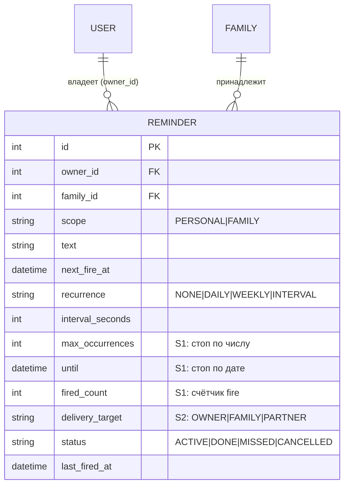
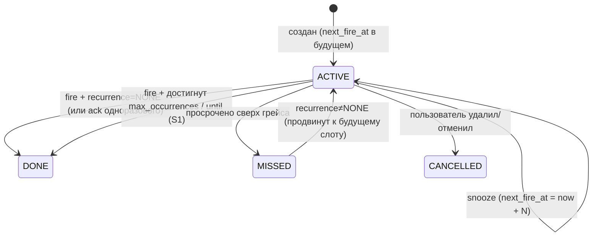

# ТЗ — Reminders (напоминания + планировщик)

**Версия:** 0.4 (дельта S1+S2 из MVP-фидбэка партии №1; форки D/B закрыты С. 2026-06-18)
**Статус:** ✅ Принято v0.4 (С., 2026-06-18); v0.3 — С./Катя 2026-06-07
**Дата:** 2026-06-18
**Опирается на:** `MVP_Requirements.md` §4.4/§5 · `DOMAIN_MODEL.md` §2/§3.5/§3.7/§4 · **`ADR-0003`** (планировщик: poll-loop, `Reminder`=SSOT, misfire, recurrence) · `ADR-0004` (изоляция) · `ADR-0005` (SQLite→Postgres) · ТЗ Identity (`Shareable`) · `05_implementation/mvp-feedback-triage.md` (S1/S2, форки D/B)
**Закрывает:** контекст «Reminders» + action item ADR-0003 №3 (поля `Reminder`, переходы, грейс-окно, ack/snooze).
**Грунт:** ADR-0003, req §4.4, DOMAIN_MODEL §3.5; существующий `services/notification_service.py` (доставка в Telegram — переиспользуется как шов к Notifications). Код напоминаний — **новый** (current-state нет).

---

## 1. Назначение и границы контекста

Reminders — создание, просмотр и **срабатывание** напоминаний с push-доставкой. В MVP — **generic** (текст + время/recurrence + владелец), без жёсткой привязки к сущностям других доменов (DOMAIN_MODEL §3.5; глубокие связи — North Star). Зависит от kernel (идентичность/видимость) и от Notifications (доставка).

**Входит:** доменная сущность `Reminder` (SSOT расписания); **планировщик** — async poll-loop в общем event-loop (ADR-0003); recurrence (`none/daily/weekly/interval`) **+ условие остановки повторений** (по числу / по дате, S1); ack/snooze; **адресат доставки** (владелец/семья/партнёр, S2); политика misfire (грейс-окно); REST Mini App (CRUD + ack/snooze). Тот же loop предоставляет **периодический триггер ретро-дайджеста** (состав/каденс — за Analytics/Катей).

**НЕ входит:** сама доставка push (контекст Notifications — ретрай, алерт админу); композиция дайджеста (Analytics); RRULE/сложные правила, привязка к спискам/финансам/еде (North Star); «назначенные» напоминания с автором/откликом получателя (за рамками S2 — решено минимально, см. §14 OQ-R5).

**Маппинг:** новый домен. Планировщик и LLM-разбора напоминаний в current-state нет; доставка переиспользует механику `notification_service` (Telegram-отправка с обработкой блокировок).

---

## 2. Глоссарий контекста
- **Reminder** — напоминание: текст + расписание (`next_fire_at` + recurrence) + владелец. **SSOT** расписания.
- **Срабатывание (fire)** — момент, когда `next_fire_at <= now`: доставка push + продвижение/закрытие.
- **Recurrence** — повторяемость: `none | daily | weekly | interval(N)`.
- **Условие остановки (recurrence end, S1)** — повтор завершается по числу срабатываний (`max_occurrences`) и/или по дате (`until`); кто наступит первым.
- **Адресат доставки (delivery target, S2)** — кому уходит push: владельцу / обоим / только партнёру.
- **Misfire** — пропуск срабатывания (процесс лежал); политика — грейс-окно.
- **Грейс-окно** — интервал, в пределах которого просроченное срабатывает один раз («догнать»); за окном — `MISSED`.
- **ack / snooze** — «выполнено» / «отложить» из push.
- scope, viewer — см. ТЗ Identity.

---

## 3. Доменная модель

### 3.1 Reminder — напоминание (SSOT, Shareable)
| Поле | Тип | NULL | Описание / инвариант |
|---|---|---|---|
| `id` | int PK | нет | — |
| `owner_id` | FK→User | нет | **Shareable.** Создатель/владелец. |
| `family_id` | FK→Family | нет | **Shareable.** Семья. |
| `scope` | enum | нет | **Shareable.** `PERSONAL` (витамины — по умолчанию) / `FAMILY` (общая задача). Управляет **видимостью** в Mini App. |
| `text` | text | нет | Что напомнить. |
| `next_fire_at` | datetime | да | **Ядро расписания** (UTC). Время следующего срабатывания; NULL = завершено/одноразовое отработало. Index. |
| `recurrence` | enum | нет | `NONE` / `DAILY` / `WEEKLY` / `INTERVAL`. |
| `interval_seconds` | int | да | Для `INTERVAL` — шаг. Для `WEEKLY` день недели берётся из `next_fire_at`. |
| `max_occurrences` | int | да | **S1.** Стоп после N срабатываний; NULL = без лимита. Только при `recurrence≠NONE`. ≥1. |
| `until` | datetime | да | **S1.** Стоп после этого момента (UTC); NULL = без даты-конца. Только при `recurrence≠NONE`. |
| `fired_count` | int | нет | **S1.** Счётчик фактических срабатываний (default 0). Растёт только на **fire** (не на ack/snooze). Состояние на `Reminder` — не журнал (R3). |
| `delivery_target` | enum | да | **S2.** `OWNER` / `FAMILY` / `PARTNER`. NULL ⇒ выводится из `scope` (PERSONAL→OWNER, FAMILY→FAMILY). `PARTNER` ⇒ push только второму члену семьи. |
| `status` | enum | нет | `ACTIVE` / `DONE` / `MISSED` / `CANCELLED`. |
| `last_fired_at` | datetime | да | Последнее фактическое срабатывание. |
| `created_at` | datetime | нет | — |
| `updated_at` | datetime | нет | `onupdate`. |

> Состояние срабатывания держится **на самом `Reminder`** (`next_fire_at`/`status`/`last_fired_at`/`fired_count`) — отдельной таблицы-журнала в MVP **нет** (решено R3: минимум, `Reminder`=SSOT; `fired_count` — счётчик на сущности, не журнал; fire-log добавляется тривиально при необходимости аудита). Переживает рестарт/деплой (ADR-0003).
>
> **Миграция:** v0.4 добавляет 4 колонки (`max_occurrences`, `until`, `fired_count`, `delivery_target`) — одна Alembic-ревизия (в волне Потока 2 вместе с Lists-дельтой). `fired_count` default 0, остальные nullable → back-compat существующих строк.

---

## 4. ERD



Намеренно одна сущность (generic-напоминания MVP). Связей с List/Finance/Food **нет** (North Star).

---

## 5. Инварианты и бизнес-правила
- **I1. (SSOT)** `Reminder.next_fire_at` — единственный источник расписания; планировщик не держит состояние в памяти → рестарт/деплой переживается без потерь/дублей (ADR-0003).
- **I2. (одноразовое)** `recurrence=NONE`: после срабатывания → `status=DONE`, `next_fire_at=NULL`.
- **I3. (повторяемое)** после срабатывания `fired_count++`, `next_fire_at` продвигается по recurrence (daily +1д, weekly +7д, interval +`interval_seconds`); затем **проверка условия остановки (I9)**; если не остановлено — `status` остаётся `ACTIVE`.
- **I4. (без двойного срабатывания)** один процесс + переход состояния (`claim → fired`/advance) в **одной транзакции**.
- **I5. (misfire)** просроченное в пределах грейс-окна срабатывает **один раз** («догнать»); за окном — `status=MISSED` (повторяемое затем продвигается к ближайшему будущему слоту, без «шторма»).
- **I6. (видимость/доставка)** **Видимость** в Mini App — kernel `visible_to` по `scope` (PERSONAL — владельцу; FAMILY — обоим). **Доставка push** — по `delivery_target` (S2): `OWNER`→владельцу; `FAMILY`→обоим; `PARTNER`→только второму члену семьи. NULL выводится из scope (PERSONAL→OWNER, FAMILY→FAMILY) — поведение v0.3 сохраняется.
- **I7. (гранулярность)** минутной точности достаточно; опрос раз в N сек (конфиг 30–60).
- **I8. (доставка не здесь)** фактическая отправка, ретрай и алерт админу при стойком фейле — контекст Notifications (ТЗ Notifications); Reminders лишь инициирует доставку.
- **I9. (остановка повторений, S1)** при `recurrence≠NONE` после продвижения `next_fire_at`: если (`max_occurrences` задан И `fired_count >= max_occurrences`) **ИЛИ** (`until` задан И `next_fire_at > until`) → `status=DONE`, `next_fire_at=NULL`. Оба условия опциональны; при обоих заданных — кто первым. Только **fire** растит `fired_count` (ack/snooze — нет).
- **I10. (адресат-партнёр, S2)** `delivery_target=PARTNER` корректен только если в семье есть второй член; иначе создание/правка → `422`. Получатель — единственный «другой» член семьи (2 пользователя в MVP). `PARTNER` влияет **только** на доставку push; видимость в Mini App остаётся по `scope` (минимальная семантика, форк B — без автора/отклика, см. §14 OQ-R5).

---

## 6. Срабатывание через generic-планировщик (ADR-0003 + аудит F2.1)

Механизм срабатывания — **job в общем generic-планировщике** (top-level `scheduler/` — инфра, peer к `notifications/`; знает только kernel). Reminders отдаёт callable «опросить созревшие → доставить»; тик планировщика в общем event-loop его вызывает. Своего loop/демона у Reminders нет; брокеров нет (ADR-0003, frozen §5). Регистрация job — в `main.py` (композиция). Сам `scheduler/` специфицируется в build-roadmap (инфра-слой).

**Тик (раз в N сек, конфиг 30–60):**
1. Выбрать «созревшие»: `SELECT … WHERE status=ACTIVE AND next_fire_at <= now()`.
2. Для каждого, в **одной транзакции**:
   - проверить грейс (now − next_fire_at): в окне → доставить через Notifications; за окном → пометить `MISSED` (без доставки);
   - `last_fired_at = now`; **`fired_count++`** (S1);
   - продвинуть `next_fire_at` по recurrence (`I3`) либо закрыть одноразовое (`DONE`, `I2`);
   - **проверить условие остановки (`I9`)**: если достигнут лимит/дата — `status=DONE`, `next_fire_at=NULL`;
3. Доставка через **Notifications** (recipients по `delivery_target`, I6) — push с кнопками **✅ Выполнено** (ack) и **⏰ Отложить 1 ч** (snooze) — **обе** (решено R1).

**Догон при старте:** на первом тике после рестарта те же правила применяются к накопившимся просрочкам (грейс-окно отсекает старое). Догон-fire тоже растит `fired_count` и проверяет I9.

**Дайджест — отдельная job** (владелец — Analytics), регистрируется в том же generic-планировщике из `main.py`. Reminders её **не знает** и Analytics **не импортирует** (исправление аудита F2.1: ребро `reminders→analytics` запрещено ADR-0004). Один планировщик на обе job — связывает их composition-слой, а не контексты. Каденс/состав дайджеста — ТЗ Analytics.

Грейс-окно — **конфиг, дефолт 3 ч** (решено R2).

---

## 7. FSM срабатывания



- **ack** «✅ Выполнено»: одноразовое → `DONE`; повторяемое → подтверждает текущее срабатывание (**расписание не трогает, `fired_count` не растит** — форк C «отметить этот раз и повторить»).
- **snooze** «⏰ Отложить N»: `next_fire_at = now + N`, `status=ACTIVE` (счётчик не растит).

---

## 8. Прикладные сценарии
- **S1. Витамины (recurring).** `POST /reminders {text:"Витамин D", fire_at:09:00, recurrence:DAILY, scope:PERSONAL}` → каждый день в 9:00 push владельцу; «✅ Выполнено» подтверждает.
- **S2. Разовая задача.** `recurrence:NONE` → один push в срок → `DONE`.
- **S3. Общая (FAMILY).** «Оплатить аренду 1-го числа» (`scope:FAMILY`) → push обоим.
- **S4. Misfire.** Процесс лежал 20 мин в момент срабатывания → на старте догоняет в грейсе (один push). Лежал сутки при грейсе 3 ч → `MISSED`, следующее (если recurring) — к ближайшему будущему слоту.
- **S5. Snooze.** Push → «Отложить 1 ч» → `next_fire_at=now+1ч`.
- **S6. Ограниченный повтор (S1).** «Принять курс антибиотика — 10 раз, каждые 8 ч»: `recurrence:INTERVAL, interval_seconds:28800, max_occurrences:10` → после 10-го fire → `DONE`. Вариант с датой: `until:"2026-07-01T00:00:00Z"` → повтор до даты. Заданы оба → кто первым.
- **S7. Напоминание партнёру (S2).** «Напомнить Кате забрать посылку» — владелец создаёт `{text, fire_at, delivery_target:PARTNER}` → push уходит только партнёру; владелец видит/правит напоминание в своём списке (видимость по scope).

---

## 9. REST-контракт

Под `/api/v1/reminders`, аутентификация — kernel `current_viewer`; видимость — `visible_to` (PERSONAL/FAMILY); ru. Ack/snooze доступны и из REST, и из callback push-кнопок (бот → тот же сервис).

| Метод | Путь | Назначение | Запрос | Ответ | Ошибки |
|---|---|---|---|---|---|
| GET | `/reminders` | Видимые напоминания (`?status=`) | — | `[ReminderDTO]` | 401,403 |
| POST | `/reminders` | Создать | `{text, fire_at, recurrence, interval_seconds?, scope?, delivery_target?, max_occurrences?, until?}` | `ReminderDTO` | 401,403,422 |
| GET | `/reminders/{id}` | Одно | — | `ReminderDTO` | 401,403,404 |
| PATCH | `/reminders/{id}` | Правка (текст/время/recurrence/scope/адресат/условие конца) | `{…}` | `ReminderDTO` | 401,403,404,422 |
| DELETE | `/reminders/{id}` | Удалить (→ `CANCELLED`) | — | `204` | 401,403,404 |
| POST | `/reminders/{id}/ack` | Выполнено | — | `ReminderDTO` | 401,403,404 |
| POST | `/reminders/{id}/snooze` | Отложить | `{minutes}` | `ReminderDTO` | 401,403,404,422 |

**DTO:**
- `ReminderDTO` = `{id, text, next_fire_at, recurrence, interval_seconds?, max_occurrences?, until?, fired_count, delivery_target, scope, status, last_fired_at, owner_id, created_at}`
- Создание: `recurrence ∈ {none,daily,weekly,interval}`; для `interval` обязателен `interval_seconds`; `fire_at` задаёт первый слот (для weekly — и день недели).
- **S1-валидация (422):** `max_occurrences`/`until` допустимы только при `recurrence≠none`; `max_occurrences ≥ 1`; `until > fire_at`.
- **S2-валидация (422):** `delivery_target ∈ {owner,family,partner}`; `partner` — только если в семье есть второй член (I10). NULL ⇒ выводится из `scope`.

---

## 10. Аутентификация, авторизация, изоляция
- Аутентификация — kernel (`current_viewer`).
- Видимость/мутации — `scope` (PERSONAL — владелец; FAMILY — оба, kernel OQ-2 «совместное владение»). Адресат push — `delivery_target` (S2), независим от видимости.
- Standalone-шов: домен и планировщик Telegram-агностичны; доставка вынесена в Notifications (ADR-0004).

**Структура пакета (ADR-0004):**
```
app/contexts/reminders/
  models/         # Reminder (+ Shareable из kernel)
  repositories/   # reminder_repo (выборка созревших по next_fire_at)
  services/       # reminder_service (CRUD, ack/snooze), reminder_poll (job: опрос созревших → доставка; recurrence, остановка, misfire)
  api/            # REST Mini App
```
**Импорты:** `contexts.reminders → kernel + notifications` (доставка; ребро Rem→Notif из графа §2) **+ generic `scheduler`** (регистрация job). `analytics`/`delivery` **не** импортируются. Generic-планировщик — top-level `scheduler/` (инфра); Reminders отдаёт job-callable, регистрирует `main.py` — поэтому ребра `reminders→analytics` нет (аудит F2.1). Определение «партнёра» для `delivery_target=PARTNER` — через kernel (членство в семье), не свой запрос.

---

## 11. Edge-cases и обработка ошибок
- **Рестарт/деплой в момент срабатывания** → состояние в БД (I1); на старте догон в грейсе (I5).
- **Долгий простой** (> грейс) → `MISSED`, без «шторма» повторов; recurring продвигается к будущему.
- **Недоставка push** (бот заблокирован / Telegram-ошибка) → обрабатывает Notifications (лог + ретрай + алерт админу при стойком фейле, ADR-0003); срабатывание не зацикливается.
- **Снуз за пределы следующего слота** (recurring) → ближайшее из (snooze-время, штатный слот).
- **Двойной тик / гонка** → транзакционный claim (I4), один push.
- **scope=FAMILY, один из партнёров заблокировал бота** → второму доставляется; фейл логируется (Notifications).
- **`until` уже в прошлом при создании** (recurrence≠NONE) → `422` (нет будущих слотов). **`max_occurrences` достигается на первом же fire** (N=1 при recurrence) → допустимо: один push → `DONE`.
- **`delivery_target=PARTNER` в одиночной семье** → `422` (I10). Если партнёр появляется/уходит после создания — на момент доставки получатель резолвится из текущего членства; нет партнёра → доставка пропускается + лог (Notifications).

---

## 12. Нефункциональные аспекты
- **Один процесс/loop, без брокеров** (frozen §5); планировщик — часть приложения.
- **Переживание рестарта** — состояние только в БД; тесты обязательны (пропуск/повтор/рестарт/грейс/остановка — ADR-0003).
- **DB-агностичность** (`next_fire_at`/`until` — datetime; без БД-специфики) — переезд SQLite→Postgres не ломает (ADR-0005).
- **Объём крошечный**, минутная точность; опрос N сек. Локализация ru; standalone-шов.
- **Таймзона (аудит F6.4):** `next_fire_at`/`until` в UTC; локальное время задаётся в `owner.timezone` (kernel) при создании; recurrence в MVP продвигается фиксированной дельтой — оба пользователя в одной зоне, DST-коррекция — North Star.

---

## 13. Критерии приёмки
- **A1.** Создание/просмотр/правка/удаление напоминаний через REST; recurrence `none/daily/weekly/interval`.
- **A2. (срабатывание)** Созревшее доставляется один раз; recurring продвигает `next_fire_at` и растит `fired_count`; одноразовое → `DONE`.
- **A3. (рестарт)** Перезапуск процесса между созданием и сроком не теряет и не дублирует срабатывание (состояние в БД).
- **A4. (misfire)** Просрочка в грейсе догоняется один раз; сверх грейса → `MISSED`; recurring продвигается к будущему слоту.
- **A5. (ack/snooze)** «Выполнено» закрывает одноразовое; повторяемое — подтверждает без сдвига расписания и без роста `fired_count`; «Отложить N» сдвигает `next_fire_at`; работает и из push-кнопки, и из REST.
- **A6. (видимость/доставка)** Видимость по `scope`; push по `delivery_target` — OWNER→владельцу, FAMILY→обоим, PARTNER→партнёру; доставка идёт через Notifications.
- **A7. (изоляция)** домен не импортирует `delivery`; планировщик в одном event-loop; import-linter зелёный.
- **A8. (остановка повторений, S1)** recurring с `max_occurrences=N` → ровно N срабатываний → `DONE`; с `until=T` → не срабатывает после T → `DONE`; оба заданы → останавливает первое наступившее; ack/snooze не влияют на `fired_count`.
- **A9. (адресат-партнёр, S2)** `delivery_target=PARTNER` → push только второму члену; в одиночной семье создание → `422`; видимость владельца сохраняется.

---

## 14. Решённые вопросы
**v0.3 (С./Катя, 2026-06-07):**
- **OQ-R1 — push-кнопки:** **обе** — `✅ Выполнено` (ack) + `⏰ Отложить 1 ч` (snooze).
- **OQ-R2 — грейс-окно misfire:** в **конфиг**, дефолт **3 ч**.
- **OQ-R3 — журнал срабатываний:** **только состояние на `Reminder`** (без отдельной таблицы); `fired_count` — счётчик на сущности (не журнал); fire-log — при необходимости аудита позже.

**v0.4 (С., 2026-06-18 — дельта по MVP-фидбэку):**
- **OQ-R4 — условие конца повторений (форк D):** **оба** — `max_occurrences` (число) и `until` (дата); опциональны; кто первым (I9).
- **OQ-R5 — адресат «только партнёру» (форк B):** **минимально** — `delivery_target=PARTNER` маршрутизирует только push; без «назначенного» напоминания (автор/принятие/отклонение получателем — вне MVP; кандидат в North Star, если понадобится двусторонний воркфлоу). Журнал «кто когда отметил» не вводим (R3).

> Решено инлайн (ADR-0003): механизм — poll-loop, `Reminder`=SSOT; recurrence `none/daily/weekly/interval` (RRULE — North Star); доставка — через Notifications. Каденс/состав дайджеста — вход ТЗ Analytics (Катя), не здесь.

---

## 15. История изменений
- **0.4 (2026-06-18):** дельта по MVP-фидбэку партии №1 (форки D/B закрыты С.). **S1** — условие остановки повторений: поля `max_occurrences`/`until`/`fired_count`, инвариант I9, шаг тика, FSM-переход, сценарий S6, валидация и A8. **S2** — адресат доставки `delivery_target` (OWNER/FAMILY/PARTNER), I6 переписан (видимость по scope ↔ доставка по target), I10, сценарий S7, валидация и A9. Миграция: +4 колонки (одна ревизия волны Потока 2). Видимость и поведение v0.3 сохранены при NULL-значениях новых полей. Форк C (ack повторяющегося) — спеку **не** менял: §7 уже корректен («подтверждает, расписание не трогает»), уточнено лишь, что ack не растит `fired_count`.
- **0.3 (2026-06-07):** аудит F2.1 — планировщик вынесен в generic top-level `scheduler/`; Reminders отдаёт job-callable, дайджест-job (Analytics) регистрируется в `main.py`; ребро `reminders→analytics` устранено. §6/§10 обновлены.
- **0.2 (2026-06-07):** закрыты OQ-R1/R2/R3 — обе push-кнопки (ack+snooze 1 ч); грейс-окно в конфиг, дефолт 3 ч; состояние только на `Reminder` (без журнала). Статус → принято.
- **0.1 (2026-06-07):** первый черновик ТЗ Reminders. Зафиксированы: `Reminder` (SSOT — `next_fire_at`/recurrence/status), планировщик-poll-loop в одном event-loop (ADR-0003), misfire-грейс, FSM срабатывания (ACTIVE/DONE/MISSED/CANCELLED), ack/snooze, REST + DTO, шов доставки к Notifications, структура пакета. 3 OQ (push-кнопки, грейс-дефолт, журнал срабатываний). Триггер дайджеста предоставляется здесь; состав — ТЗ Analytics.
