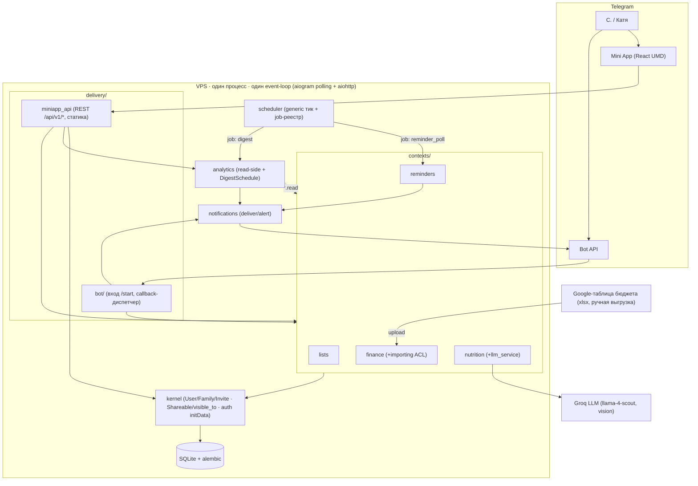
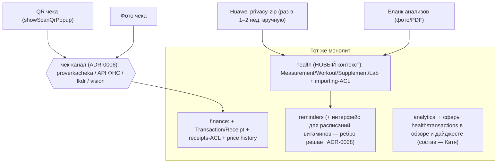
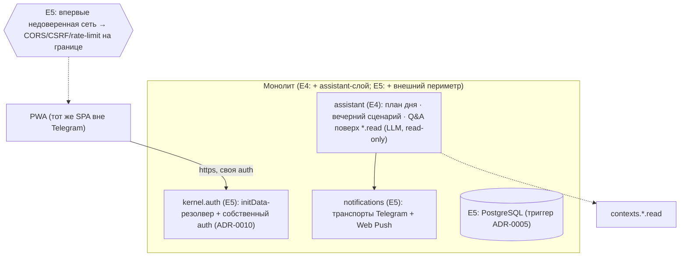

# Архитектурная схема и её эволюция по этапам

**Дата:** 2026-06-10. Уровень — контейнеры/пакеты (C4-light). Доменные границы E1 — `DOMAIN_MODEL.md` §2 (не дублируются); здесь — физическая картинка и её дельты E2→E5.
**Инвариант программы:** один процесс, один деплой, модульный монолит до E5 включительно; растёт **внутреннее** дерево пакетов и набор ACL-адаптеров, не количество сервисов.

---

## 1. E1 (MVP) — текущая target-архитектура

Ключевые швы (enforced import-linter): домены ↔ только kernel; analytics ↔ только `*.read`; Telegram заперт в delivery+notifications+kernel.auth; интеграционная грязь — в ACL (`finance/importing`).

---

## 2. Дельта E2–E3 — рост внутрь + новые ACL

Принцип «вся интеграция = заменяемый адаптер» масштабируется: xlsx (E1) → чек-канал (E2) → huawei-zip (E3). Деградация любого внешнего канала не трогает домен.

---

## 3. Дельта E4–E5 — проактивный слой и второй периметр

E4 не добавляет write-моделей (композиции + третья job планировщика). E5 не меняет домены вообще — меняются края: auth-резолвер, транспорт уведомлений, БД под собой, внешний периметр.

---

## 4. Что architectural-инвариантно на всю программу

1. Домены не знают про Telegram, LLM-провайдера, формат внешних файлов и транспорт push — всё за швами (kernel.auth / llm_service / ACL / notifications).
2. `visible_to` — единственный путь чтения shareable-данных на любом этапе; health-данные расширяют модель только значением `PERSONAL`-дефолта, не механизмом.
3. Один scheduler на все периодические job (reminder_poll, digest, E4-план, E3-напоминание об экспорте) — job добавляются регистрацией в композиции, не новыми лупами.
4. Analytics/assistant читают только `*.read`-проекции — рост проактивности не повышает связность доменов.
5. Любое новое межконтекстное ребро (E3: health→reminders; E4: связки закупок) — явное решение ADR + правка import-linter, никогда «просто импорт».

## История изменений
- **2026-06-10:** первичная версия (E1 картинка + дельты E2–E3, E4–E5, программные инварианты).
