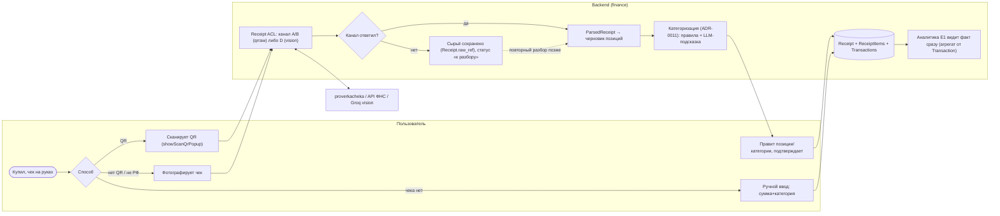
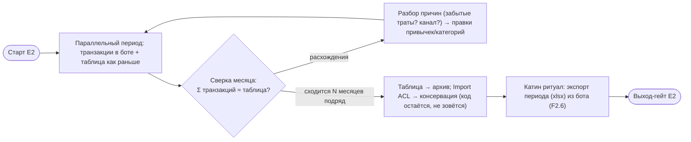
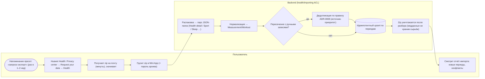
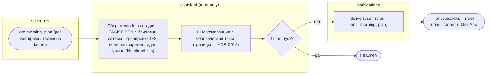
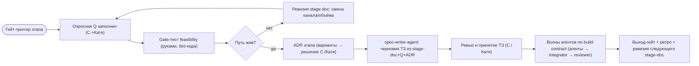

# Ключевые процессы (BPMN-style, mermaid)

**Дата:** 2026-06-10. Дорожки (swimlane) — через subgraph: Пользователь / Mini App / Backend / Внешний мир. Процессы E1 здесь **не дублируются** — их FSM уже в ТЗ (пейринг — Identity §6; analyze→confirm→save — Nutrition §7; срабатывание напоминания — Reminders §6–7; импорт xlsx — Finance §7; дайджест — Analytics §7). Здесь — новые процессы E2–E4.
**Формат:** mermaid (рендерится в вашем тулчейне). Если для какого-то процесса понадобится строгий BPMN 2.0 XML (Camunda-стиль) — генерируется из этих описаний по запросу.

---

## P1 (E2) — Чек: от кассы до транзакций

Свойства: ничего не пишется без подтверждения (analyze→confirm→save); фейл канала не теряет чек (сырьё сохраняется); ручной ввод — равноправный вход, не исключение.

---

## P2 (E2) — Переход SSOT: таблица → транзакции (ADR-0007)

Длительность параллельного периода и критерий «сходится» — параметры ADR-0007 (страховка от потери доверия к данным).

---

## P3 (E3) — Huawei-импорт здоровья

Паттерн идентичен импорту бюджета (E1): ручная выгрузка → ACL → идемпотентный upsert → отчёт. Отличие — уничтожение сырья (приватность).

---

## P4 (E4) — Утренний план дня

Per-user (не per-family): план личный, состав фильтрован видимостью (цикл-фаза Кати не попадает к С. без явного шаринга).

---

## P5 (программный) — Конвейер этапа (как открывается любой E)

## История изменений
- **2026-06-10:** первичная версия (P1–P5).
