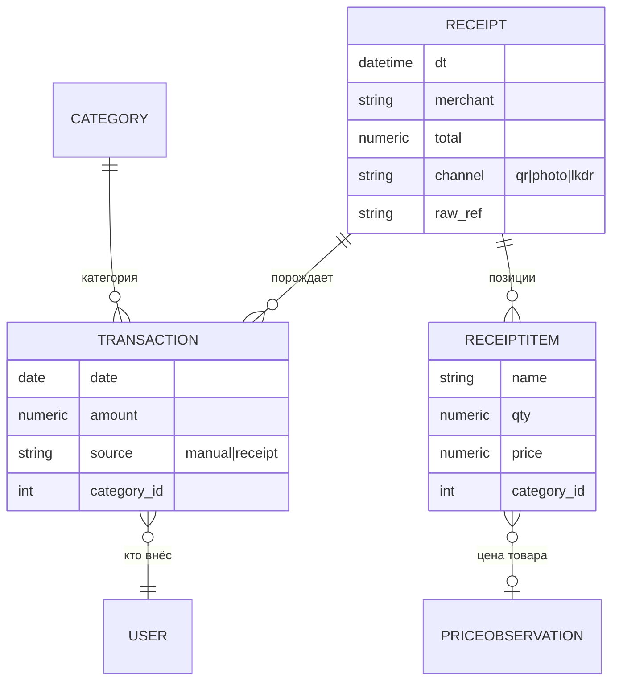

# Этап E2 — Финансы-автоматизация (stage-doc)

**Статус:** каркас этапа (стабильный уровень). Детальное ТЗ — на входе этапа: Q2 заполнен + gate-тест чеков + ADR-0006/0007/0011 приняты.
**Драйвер:** С. — «идеал, когда абсолютно все траты автоматически с чеками вносятся в систему» (сырые ответы, Q2). Катя — ввод доход/расход чеками + ручной («есть места без чеков»), «главное чтоб была выгрузка и аналитика».
**Грунт:** North Star backlog (req §8 «Финансы»), feasibility §2 (каналы чеков), E1-домен Finance (категории/план/факт/доходы уже живут).

---

## 1. Цель и ценность

Убрать ручную Google-таблицу из контура: траты попадают в систему **в момент покупки** (QR чека / фото / ручной ввод за 10 секунд), аналитика E1 продолжает работать поверх — но уже на живых данных, а не на месячном импорте. Выход-гейт: месяц жизни без таблицы.

## 2. Объём этапа (фичи)

| ID | Фича | Прио | Суть |
|---|---|---|---|
| F2.1 | **Ручной ввод транзакции** | must | Mini App: сумма + категория (из живой таксономии E1) + дата + опц. комментарий; ≤10 сек на ввод. Покрывает «места без чеков» (Катя). |
| F2.2 | **Чек по QR** | must | Сканер QR в Mini App (`showScanQrPopup`) → `qrraw` → канал-адаптер (ADR-0006) → позиции чека → экран подтверждения → транзакции. |
| F2.3 | **Чек по фото (vision-fallback)** | must | Фото чека → vision-LLM → позиции (паттерн analyze→confirm→save). Строится всегда — fallback канала и путь для не-QR чеков. |
| F2.4 | **Категоризация позиций** | must | Маппинг позиций чека на таксономию категорий: правила/словарь + LLM-подсказка + ручная правка (развилка — ADR-0011). Чек целиком может лечь одной транзакцией на категорию или разбиться по позициям (Q2). |
| F2.5 | **Смена SSOT** | must | Транзакции становятся источником факта; план остаётся ручным (редактор плана в Mini App — лёгкий CRUD на `BudgetPlan`). Судьба таблицы/Import ACL и переходный период — ADR-0007. |
| F2.6 | **Выгрузка** | should | Экспорт периода (xlsx/csv) — Катин «ритуал рефлексии» и страховка от lock-in (RA-2; формат — Q2). |
| F2.7 | **История цен** | could | Из item-level чеков копится `PriceObservation` (товар, магазин, цена, дата) → «курица в Пятёрочке дешевела» (мечта С. о сравнении цен — фундамент, без рекомендаций пока). |
| F2.8 | Планирование закупок | out → E4 | «План и стоимость покупок на неделю от еды и трат» — требует данных E2 + связки со списками; уходит в E4 (проактивный слой). |

**Вне объёма:** автоматический захват чеков без действия пользователя (подписка lkdr — максимум опция канала, не обязательство); мультивалютность (если не всплывёт в Q2); инвестиции/счета.

## 3. Доменные дельты (концептуально)

Контекст Finance расширяется (не новый контекст):

- `ActualAmount` (дневной факт E1) — **производное**: либо агрегат от `Transaction`, либо сосуществование на переходный период (ADR-0007 решает механику, инвариант «аналитика E1 не замечает смены источника» обязателен).
- **Receipt ACL** (`finance/receipts/` или peer-пакет): канал A/B/C/D за единым интерфейсом `fetch(qrraw|photo) → ParsedReceipt` — тот же паттерн, что Import ACL. openpyxl-правило повторяется: специфика канала заперта в адаптере.
- Видимость: весь Finance остаётся `FAMILY` (E1-решение), `Transaction.created_by` — информационное поле, не приватность.

## 4. Интеграции (вердикты — feasibility §2)

Канал A (proverkacheka, 15/день free) ⚠️ gate-тест · канал B (офиц. API ФНС) ⚠️ изучить ТУ · канал C (lkdr) ⚠️ хрупкий, опция · канал D (vision) ✅ всегда. **Юрисдикция покупок — ключевой вопрос Q2:** если заметная доля вне РФ, A–C отпадают для неё, D становится основным.

## 5. ADR этапа

ADR-0006 (канал чека + порядок деградации) · ADR-0007 (смена SSOT, судьба таблицы/импорта, переходный период) · ADR-0011 (категоризация позиций). Все три — на входе этапа, после Q2 и gate-теста.

## 6. NFR-дельты

Ввод с телефона «на кассе» — топ-приоритет UX (≤10 сек, работает одной рукой); LLM-вызовы в лимитах Groq (≈5–10/день — запас есть); fail чека → транзакция не теряется (сохранить сырьё, доразобрать позже); чеки-сырьё (фото/JSON) хранить со ссылкой из Receipt (диск VPS — кап/чистка).

## 7. Связи и риски

- **Связь со списками покупок** («купил всё или не всё по списку» — С.): в E2 НЕ строим (DOMAIN_MODEL §5 держим слабую связность); фундамент — `ReceiptItem` уже структурный. Сопоставление список↔чек — E4-кандидат.
- **Риск таксономии:** позиции чека гранулярнее категорий бюджета («Молоко 3.2%» → «ВкусВилл»?) — категоризация на уровне чека-целиком vs позиций — явный вопрос Q2/ADR-0011.
- **Риск отмирания канала A** (неофициальный) → митигируется адаптерной архитектурой + каналом D.

## 8. Вход/выход

**Вход:** Q2 → gate-тест → ADR → ТЗ (spec-writer-agent: дельта-ТЗ к spec-finance + новое spec-receipts при необходимости) → волна агентов.
**Выход:** месяц трат в боте без таблицы; таблица — архив; ретро.

## История изменений
- **2026-06-10:** первичный каркас этапа.
