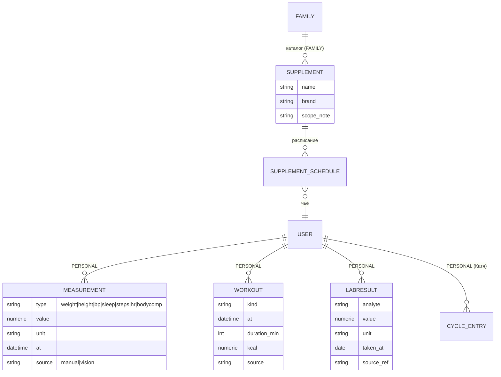

# Этап E3 — Здоровье (stage-doc)

**Статус:** каркас этапа. Детальное ТЗ — на входе: Q3 заполнен + gate-тест vision-разбора 3–5 скринов тренировки/сна (#16) + ADR-0008/0009 приняты.
**Драйвер:** Катя (медблок, цикл, витамины, статистика тренировок — «блок важный, идей достаточно»); С. (взвешивание, зал, состав тела, сон — сценарий «идеального дня»).
**Грунт:** North Star backlog (req §8 «Здоровье»), feasibility §1/§4, сырые ответы (Катя Б2-2, С. Б1-3); существующие Nutrition (КБЖУ — остаётся своим контекстом) и Reminders (generic — переиспользуются).

---

## 1. Цель и ценность

Вторая половина «здоровья» (первая — питание, уже в E1): тренировки, вес/состав тела, данные с часов, витамины, медицинские показатели и цикл — в одном месте, со статистикой и подсказками, с приватностью по умолчанию.

## 2. Объём этапа (фичи)

| ID | Фича | Прио | Суть |
|---|---|---|---|
| F3.1 | **Журнал веса/измерений** | must | Утреннее взвешивание за 5 сек (сценарий С.); график динамики; источник — ручной + скрин-разбор (vision; вес — опц. метрика). |
| F3.2 | **Журнал тренировок** | must | Ручной лог: тип (волейбол/бег/вело/зал/др.), длительность, опц. калории/заметка; статистика по типам и периодам (Катя). Источник — ручной + скрин-разбор (vision). |
| F3.3 | **Скрин-разбор тренировки/сна (vision)** | must | Скрин экрана Huawei Health (тренировка/сон/шаги) → vision-LLM (паттерн фото-еды/чеков): analyze→confirm→save; сводно тип/длительность/калории, сон, шаги (метрики С., #16; вес — опц.; пульс/зоны/темп — вне scope). Дубли ручное-vs-разбор — ADR-0008. Ритм: раз в 1–2 недели; **gate-тест vision-разбора 3–5 скринов — С., до ТЗ**. _(Huawei privacy-zip отклонён #16; Health Kit API — North Star.)_ |
| F3.4 | **Витамины** | must | Каталог «что у нас есть» (название, производитель, состав-скоуп, чьё) + расписание приёма → генерирует Reminders (глубокая связь Reminders↔домен — первая, аккуратно через явный интерфейс; до этого Reminders generic). |
| F3.5 | **Медблок: показатели и анализы** | should | Рост/вес/давление и лабораторные показатели; загрузка бланка (фото/PDF) → LLM-извлечение → подтверждение → динамика по показателю. Модель — ADR-0009. Исходник хранится. |
| F3.6 | **Цикл** | should | Ввод цикла + календарная фаза + подсказки к тренировкам по фазе (Катя). Строго `PERSONAL` по умолчанию; что и в каком виде шарится — только явно (Q3). |
| F3.7 | **Состав тела** | could | Фото листка анализатора из зала → vision-извлечение → динамика (С.). |
| F3.8 | Напоминания о врачах | — | Уже покрыто generic Reminders (E1); в E3 — максимум пресет/категория. |

**Вне объёма:** realtime-синк с часами (канала нет — feasibility §1); план тренировок от ИИ (E4-кандидат, упомянут С.); Huawei privacy-zip (отклонён #16); Huawei Health Kit API (North Star — тяжёлая бюрократия со scopes, не инвестируем без явного повода); глубокая аналитика пульса/зон/темпа.

## 3. Доменные дельты (концептуально)

Новый bounded context **Health** (peer к Nutrition; КБЖУ остаётся в Nutrition — границу не размываем):

- `Measurement` универсальная vs таблицы по типам — главная развилка ADR-0009 (эскиз выше — вариант «универсальная», не решение).
- **Vision-разбор скринов** (`health/...`): скрин → vision-LLM → нормализованные Measurement/Workout (через `llm_service`, паттерн фото-еды). _(Huawei privacy-zip ACL отклонён #16; импорт-канал к Health Kit API — North Star.)_
- **Связь с Reminders (F3.4):** Health создаёт/обновляет Reminder'ы расписания витаминов через публичный сервис Reminders (направление `health → reminders` — новое ребро графа! Зафиксировать в ADR-0008/доменной модели и import-linter; альтернатива — композиция в delivery). Это первое осознанное межконтекстное ребро — решать явно, не протаскивать.
- **Видимость:** механизм — kernel-`scope`; **дефолт scope — per-user настройка владельца** (позиция С., 2026-06-10: свои данные `FAMILY` — «открыто между нами»; Катин дефолт — её ответ Q3-В8). `SUPPLEMENT`-каталог — `FAMILY`; **цикл — всегда `PERSONAL` Кати**, любые производные наружу — только её явное решение.

## 4. Интеграции (вердикты — feasibility §1/§4)

Скрины тренировки/сна → vision ✅ ведущий путь (#16) (gate-тест: vision-разбор 3–5 скринов тренировки/сна, как еда/чеки); анализы/состав тела через vision ✅/⚠️ (gate: 3 реальных бланка); Huawei privacy-zip ❌ провалён (#16, отклонён); Health Kit API — North Star (бюрократия со scopes); Health Connect/Google Fit ❌ не закладываем.

## 5. ADR этапа

ADR-0008 (vision-канал скринов тренировки/сна + дедупликация ручное/разбор + новое ребро health→reminders; Huawei privacy-zip отклонён #16, Health Kit API — North Star) · ADR-0009 (модель показателей + хранение исходников).

## 6. NFR-дельты

Меддданные — максимум приватности (PERSONAL, без появления в FAMILY-дайджесте без явного согласия — правка композиции Analytics); файлы-исходники (PDF/фото) — кап диска VPS + чистка; LLM-извлечение всегда через confirm-экран.

## 7. Риски

Ритм ручной загрузки скринов надоест → деградация данных (митигация: напоминание-пресет «загрузи скрины», лёгкость загрузки; Health Kit API остаётся как North Star-канал); точность vision на скринах разных версий приложения (митигация: confirm-экран + тесты на реальных скринах); чувствительность цикл-данных (митигация: PERSONAL-дефолт + Q3 о границах).

## 8. Вход/выход

**Вход:** Q3 → gate-тесты (vision-разбор 3–5 скринов тренировки/сна, бланки) → ADR-0008/0009 → ТЗ (`spec-health.md` + дельта Analytics для новых сфер в обзоре/дайджесте — состав решает Катя в Q3) → волна агентов.
**Выход:** скрин-разбор тренировки/сна — рутина ≤2 нед; вес/тренировки/витамины живут в боте; Катины «важные блоки» закрыты или осознанно перенесены.

## История изменений
- **2026-06-20 (#16):** канал E3 приведён к канону `feasibility.md` #16 — ведущий путь = скрины тренировки/сна → vision (analyze→confirm→save), F3.3 переписана, gate = vision-разбор 3–5 скринов; Huawei privacy-zip отклонён, Health Kit API → North Star; пульс/зоны/темп вне scope. ADR-0008/0009 сохранены, привязаны к vision-каналу.
- **2026-06-10:** первичный каркас этапа.
