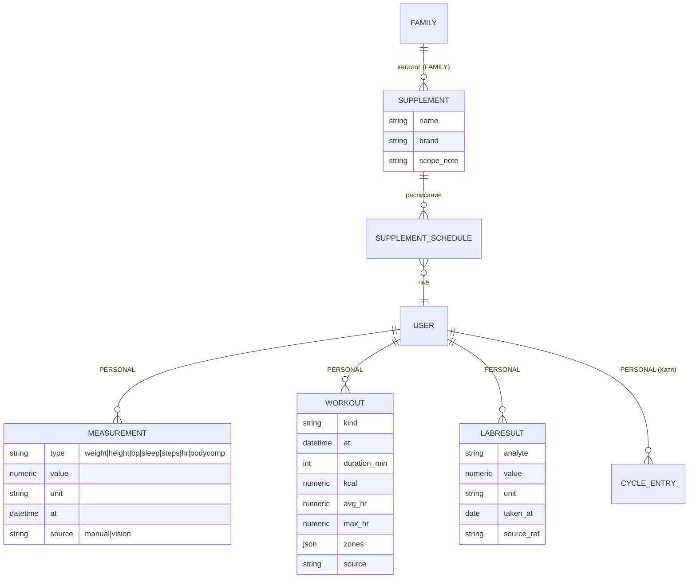

# Этап E3 — Здоровье (stage-doc)

**Статус:** каркас этапа. Детальное ТЗ — на входе: Q3 заполнен + gate-тест vision-разбора 3–5 скринов тренировки/сна (#16) + ADR-0008/0009 приняты.
**Драйвер:** Катя (медблок, цикл, витамины, статистика тренировок — «блок важный, идей достаточно»); С. (взвешивание, зал, состав тела, сон — сценарий «идеального дня»).
**Грунт:** North Star backlog (req §8 «Здоровье»), feasibility §1/§4, сырые ответы (Катя Б2-2, С. Б1-3); существующие Nutrition (КБЖУ — остаётся своим контекстом) и Reminders (generic — переиспользуются).

---

## 1. Цель и ценность

Вторая половина «здоровья» (первая — питание, уже в E1): тренировки, вес/состав тела, данные с часов, витамины, медицинские показатели и цикл — в одном месте, со статистикой и подсказками, с приватностью по умолчанию.

## 2. Объём этапа (фичи)

| ID | Фича | Прио | Суть |
|---|---|---|---|
| F3.1 | **Журнал веса/измерений** | must | Утреннее взвешивание за 5 сек (сценарий С.); график динамики; источник — ручной + скрин-разбор (vision; вес — опц. метрика). |
| F3.2 | **Журнал тренировок** | must | Ручной лог + скрин-разбор (vision): тип, длительность, калории, **пульс (средний/макс + минуты по зонам — Q3-В2/В3, со скрина)**. Статистика (Катя, Q3-В3): частота/калории по типам и периодам, общий расход ккал за месяц, шаги, км, личные рекорды. |
| F3.3 | **Скрин-разбор тренировки/сна (vision)** | must | Скрин экрана Huawei Health → vision-LLM (паттерн фото-еды/чеков): analyze→confirm→save; сводно тип/длительность/калории, сон, шаги/активность, **сводный пульс (средний/макс) + минуты по зонам** (Q3-В2, Катя; со скрина читаются дёшево). Вне scope: непрерывная кривая пульса и темп. **NB:** один скрин ≠ все поля — тип/км/шаги на других экранах → может требоваться 2–3 скрина. Дубли ручное-vs-разбор — ADR-0008. Ритм: **скрин раз в 1–3 дня** (Q3-В1, С.); gate-тест vision-разбора 3–5 скринов — С., до ТЗ. _(Huawei privacy-zip отклонён #16; Health Kit API — North Star.)_ |
| F3.4 | **Витамины** | must | Каталог (Q3-В4, Катя): название, производитель, состав, остаток/кол-во, **ссылка-заказ**, **«совместимо с» — справочное поле** (активные подсказки совместимости — рекомендация → E4, не E3). Расписание: время приёма, отметка «принял сегодня», даты курса, отмена всех, **пауза/возобновление курса** → генерирует Reminders (первая глубокая связь Reminders↔домен, через явный интерфейс). Владение — личное (каждый ведёт свои). |
| F3.5 | **Медблок: показатели и анализы** | should | Загрузка бланка (фото/PDF) → LLM-извлечение → подтверждение → динамика. **Перечень показателей не фиксирован** (Q3-В5, Катя: каждый раз разный — вкл. УЗИ и нечисловые заключения) → гибкая схема {показатель, значение, ед., дата, провенанс} + хранение исходника. Модель — ADR-0009 (аргумент за «универсальную Measurement»). |
| F3.6 | **Цикл** | should | Ввод дат фаз + симптомов (Катя вводит сама) + календарная фаза. Приватность (Q3-В6/В8): дефолт `PERSONAL`, Катя разрешает **FAMILY-read** — партнёр **видит, но не редактирует** (read-only, ADR-0016). Производные сигналы/умные напоминания партнёру и подсказки-рекомендации по фазе — **вне E3** (→ E4, реш. С. 2026-06-25). |
| F3.7 | **Состав тела** | should (↑ из could) | Фото листка анализатора (InBody) → vision-извлечение → динамика. **Оба** пользователя (С. ~раз/мес, Катя ad-hoc; Q3-В7). Поля — InBody-схема (вес/мышцы/жир%/вода/белок/кости + висц.жир/ИМТ/безжир.масса/обмен/норма ккал/оптим.вес + сегментарка + статус-vs-норма). Образец: `samples/260623_inbody_result.pdf`. |
| F3.8 | Напоминания о врачах | — | Уже покрыто generic Reminders (E1); в E3 — максимум пресет/категория. |

**Вне объёма:** realtime-синк с часами (канала нет — feasibility §1); Huawei privacy-zip (отклонён #16); Huawei Health Kit API (North Star); непрерывная кривая пульса и темп (со скрина не берутся; сводный пульс/зоны — В scope); **LLM-рекомендации по здоровью** (тренировки по фазе цикла, умные напоминания «покорми вкусняшками», план тренировок от ИИ) — вынесены в **E4+** (реш. С. 2026-06-25: иначе слишком много в один этап).

## 3. Доменные дельты (концептуально)

Новый bounded context **Health** (peer к Nutrition; КБЖУ остаётся в Nutrition — границу не размываем):

- `Measurement` универсальная vs таблицы по типам — главная развилка ADR-0009 (эскиз выше — вариант «универсальная», не решение).
- **Vision-разбор скринов** (`health/...`): скрин → vision-LLM → нормализованные Measurement/Workout (через `llm_service`, паттерн фото-еды). _(Huawei privacy-zip ACL отклонён #16; импорт-канал к Health Kit API — North Star.)_
- **Связь с Reminders (F3.4):** Health создаёт/обновляет Reminder'ы расписания витаминов через публичный сервис Reminders (направление `health → reminders` — новое ребро графа! Зафиксировать в ADR-0008/доменной модели и import-linter; альтернатива — композиция в delivery). Это первое осознанное межконтекстное ребро — решать явно, не протаскивать.
- **Видимость:** механизм — kernel-`scope` + **новый примитив read-only** (owner-write / family-read — партнёр видит, не редактирует; ADR-0016, реш. С. 2026-06-25 «проработать модель»). Дефолт scope — per-user настройка владельца (Катя Q3-В8: «всё общее»; С.: `FAMILY` «открыто между нами»). `SUPPLEMENT`-каталог — `FAMILY`. **Цикл:** дефолт `PERSONAL`, Катя разрешает FAMILY-**read** (С. видит фазы/симптомы, не редактирует); производные наружу/в дайджест — только её явное решение.

## 4. Интеграции (вердикты — feasibility §1/§4)

Скрины тренировки/сна → vision ✅ ведущий путь (#16); со скрина берём сводный пульс/зоны (Q3-В2), не кривую/темп; один скрин ≠ все поля (тип/км/шаги на др. экранах) → 2–3 скрина. Gate: vision-разбор 3–5 скринов. Анализы/состав тела через vision ✅/⚠️ (gate: 3 бланка; InBody — образец в `samples/`). Huawei privacy-zip ❌ (#16); Health Kit API — North Star; Health Connect/Google Fit ❌.

## 5. ADR этапа

ADR-0008 (vision-канал скринов + сводный пульс/зоны в scope + дедупликация ручное/разбор + ребро health→reminders) · ADR-0009 (модель показателей — гибкая/универсальная + хранение исходников) · **ADR-0016 (read-only sharing: owner-write/family-read — для цикла и опц. др. данных; kernel-уровень)**.

## 6. NFR-дельты

Меддданные — максимум приватности (PERSONAL-дефолт; шеринг — read-only, владелец пишет, партнёр читает; в FAMILY-дайджест — только с явного согласия); файлы-исходники (PDF/фото) — кап диска VPS + чистка; LLM-извлечение всегда через confirm-экран. **Право записи (read-only) проверяется на уровне сервисов/репозиториев, не только UI.**

## 7. Риски

Ритм загрузки скринов (раз в 1–3 дня) надоест → деградация (митигация: напоминание-пресет, лёгкость загрузки); точность vision на разных версиях приложения (митигация: confirm-экран + тесты на реальных скринах); чувствительность цикл-данных (митигация: PERSONAL-дефолт, read-only шеринг, enforcement записи на сервисах); **read-only — новый инвариант → покрыть тестами (партнёр не может изменить чужое).**

## 8. Вход/выход

**Вход:** Q3 → gate-тесты (vision-разбор 3–5 скринов тренировки/сна, бланки) → ADR-0008/0009 → ТЗ (`spec-health.md` + дельта Analytics для новых сфер в обзоре/дайджесте — состав решает Катя в Q3) → волна агентов.
**Выход:** скрин-разбор тренировки/сна — рутина (раз в 1–3 дня); вес/тренировки/витамины живут в боте; Катины «важные блоки» закрыты или осознанно перенесены.

## История изменений
- **2026-06-25 (решения С. по Q3, раунд-1):** пульс сводный (средний/макс) + минуты по зонам — В scope (F3.2/F3.3, со скрина; кривая/темп — вне); ритм скринов → раз в 1–3 дня; витамины (F3.4) — ссылка-заказ, «совместимо с» справочно, пауза/возобновление, личное владение; анализы (F3.5) — гибкая схема + нечисловое; цикл (F3.6) — read-only шеринг (партнёр видит, не редактирует), рекомендации/сигналы → E4; состав тела (F3.7) could→should (оба регулярно, InBody, образец в samples/); LLM-рекомендации по здоровью → E4; новый ADR-0016 (read-only sharing).
- **2026-06-20 (#16):** канал E3 приведён к канону `feasibility.md` #16 — ведущий путь = скрины тренировки/сна → vision (analyze→confirm→save), F3.3 переписана, gate = vision-разбор 3–5 скринов; Huawei privacy-zip отклонён, Health Kit API → North Star; пульс/зоны/темп вне scope. ADR-0008/0009 сохранены, привязаны к vision-каналу.
- **2026-06-10:** первичный каркас этапа.
